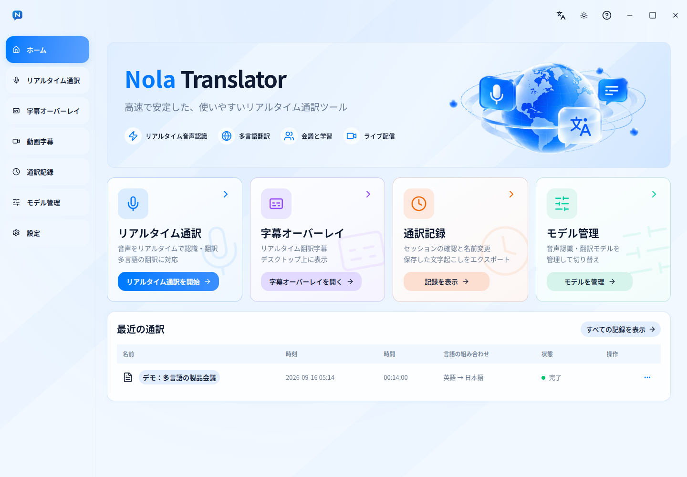
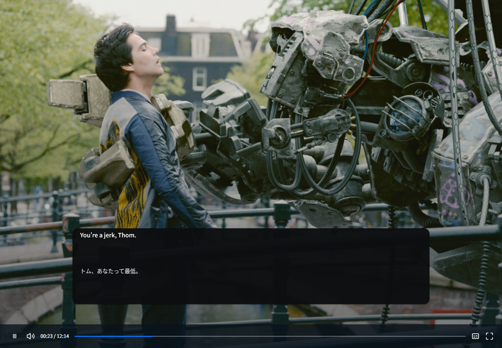
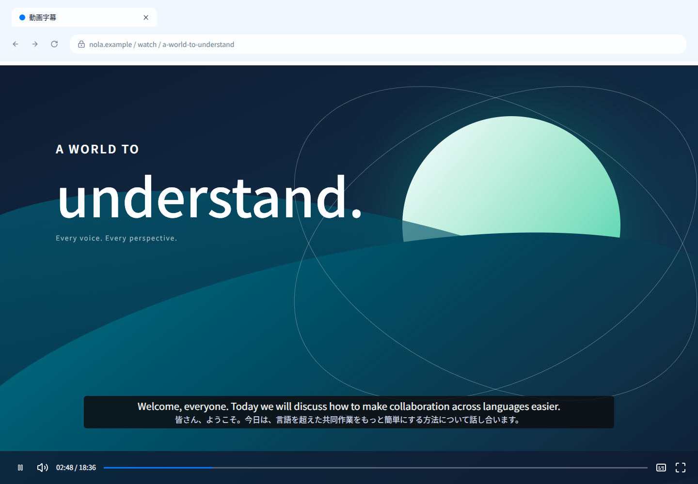
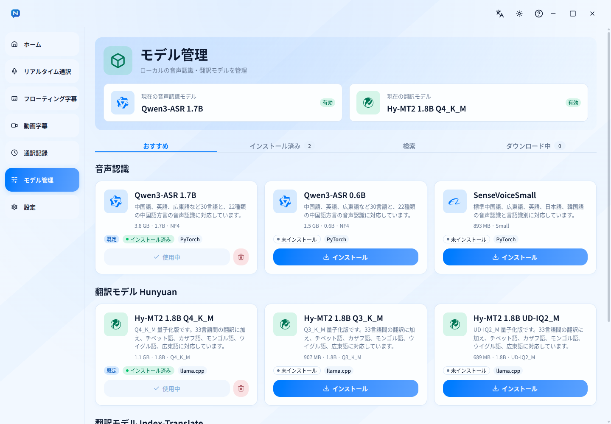

<div align="center">
  
  <h1>Nola Translator</h1>
  <p>リアルタイム字幕・翻訳アプリ</p>
  <p><a href="README.md">English</a> · <a href="README.zh-CN.md">简体中文</a> · <a href="README.zh-TW.md">繁體中文（台灣）</a> · <a href="README.zh-HK.md">繁體中文（香港）</a> · <a href="README.ja.md">日本語</a> · <a href="README.ko.md">한국어</a></p>
</div>

<p align="center">
  <a href="./LICENSE"></a>
  <a href="https://github.com/CerealAxis/Nola-Translator/actions/workflows/build.yml"></a>
  <a href="https://github.com/CerealAxis/Nola-Translator/actions/workflows/build.yml"></a>
  <a href="https://github.com/CerealAxis/Nola-Translator/releases"></a>
  <a href="https://github.com/CerealAxis/Nola-Translator/releases/latest"></a>
  
  
  
  
</p>

<p align="center">
  
</p>

## 概要

Nola Translator は、ローカルモデルとクラウドモデルを使えるリアルタイム字幕・翻訳アプリです。お使いの環境や用途に合わせて、PC 上で音声認識・翻訳を行う方法と、クラウドモデルを利用する方法を選べます。

## 機能

- **ローカルモデル:** Qwen3-ASR や SenseVoiceSmall などの認識モデル、HY-MT2 などの翻訳モデルをローカルで実行できます。Hugging Face の他のモデルを検索してインストールすることもできます。
- **クラウドモデル:** Aliyun、MiniMax などのクラウド音声認識モデルに対応しています。OpenAI 互換 API、Anthropic、Ollama などの LLM プロトコルのほか、無料の MyMemory 翻訳サービスも利用できます。
- **GPU アクセラレーション:** 利用可能な計算デバイスを検出し、認識と翻訳に別々のデバイスを設定できます。
- **ブラウザー拡張機能:** Chrome と Edge 用の拡張機能で動画ページに二言語字幕を表示できます。デスクトップのシステム音声を入力ソースに設定することもできます。
- **字幕オーバーレイ:** システム音声、選択したオーディオデバイス、またはマイクの音声を字幕にできます。字幕は独立したウィンドウに表示され、位置、文字サイズ、色、不透明度、原文と翻訳の配置を調整できます。
- **柔軟な設定:** 必要なモデルをインストールし、認識・翻訳方式、言語の組み合わせ、計算デバイス、字幕スタイルを選択できます。API 認証情報はアプリ内に安全に保存されます。
- **履歴とエクスポート:** 字幕履歴を保存し、TXT、SRT、WebVTT 形式でエクスポートできます。音声録音の保存は任意です。

## 画面プレビュー

| ホーム | 字幕オーバーレイ | 動画字幕 |
|---|---|---|
|  |  |  |

| ローカルモデルのインストール | 推論環境の設定 | ダークモード |
|---|---|---|
|  |  |  |

字幕オーバーレイとブラウザー字幕の背景には、[Blender Foundation の *Tears of Steel*](https://commons.wikimedia.org/wiki/File:Tears_of_Steel_frame_05_6a.jpg) の映像を切り抜いて使用しています。[CC BY 3.0](https://creativecommons.org/licenses/by/3.0/) に基づいています。

## インストール

- [最新リリースをダウンロード](https://github.com/CerealAxis/Nola-Translator/releases/latest)

対応 OS は Windows x64 です。EXE または MSI インストーラーを選べます。ほかのプラットフォームにも今後対応する予定です。

- [ヘルプドキュメント](https://nola.xaviermc.top/ja/)

## ローカル音声認識モデル

> [!TIP]
> 認識・翻訳に使える言語は、選択したモデルによって異なります。以下の表は、アプリで推奨しているモデルの対応言語です。ほかにおすすめのモデルがあれば、GitHub の Issue でお知らせください。アプリへの追加を検討します。初めて使う方には、音声認識に **SenseVoiceSmall**、翻訳に **HY-MT2** がおすすめです。

| モデル | 言語数 | 詳細 |
|---|---:|---|
| Qwen3-ASR | 30 | 中国語、英語、広東語、アラビア語、ドイツ語、フランス語、スペイン語、ポルトガル語、インドネシア語、イタリア語、韓国語、ロシア語、タイ語、ベトナム語、日本語、トルコ語、ヒンディー語、マレー語、オランダ語、スウェーデン語、デンマーク語、フィンランド語、ポーランド語、チェコ語、フィリピノ語、ペルシア語、ギリシャ語、ハンガリー語、マケドニア語、ルーマニア語 |
| SenseVoiceSmall | 5 | 中国語、英語、広東語、日本語、韓国語 |
| Fun-ASR Nano | 4 | 中国語、英語、日本語、広東語 |
| VibeVoice-ASR | 48 | 英語、中国語、スペイン語、ポルトガル語、ドイツ語、日本語、韓国語、フランス語、ロシア語、インドネシア語、スウェーデン語、イタリア語、ヘブライ語、オランダ語、ポーランド語、ノルウェー語、トルコ語、タイ語、アラビア語、ハンガリー語、カタロニア語、チェコ語、デンマーク語、ペルシア語、アフリカーンス語、ヒンディー語、フィンランド語、エストニア語、ギリシャ語、ルーマニア語、ベトナム語、ブルガリア語、アイスランド語、スロベニア語、スロバキア語、リトアニア語、スワヒリ語、ウクライナ語、ラトビア語、クロアチア語、ネパール語、セルビア語、フィリピノ語、マレー語、ウルドゥー語、モンゴル語、アルメニア語、ジャワ語 |
| MiMo-V2.5-ASR | 3 | 中国語、英語、広東語 |

## ローカル翻訳モデル

| モデル | 言語数 | 詳細 |
|---|---:|---|
| HY-MT2 | 38 | 簡体字中国語、繁体字中国語、英語、フランス語、ポルトガル語、スペイン語、日本語、トルコ語、ロシア語、アラビア語、韓国語、タイ語、イタリア語、ドイツ語、ベトナム語、マレー語、インドネシア語、フィリピノ語、ヒンディー語、ポーランド語、チェコ語、オランダ語、クメール語、ミャンマー語、ペルシア語、グジャラート語、ウルドゥー語、テルグ語、マラーティー語、ヘブライ語、ベンガル語、タミル語、ウクライナ語、チベット語、カザフ語、モンゴル語、ウイグル語、広東語 |
| M2M100 418M | 100 | アフリカーンス語、アムハラ語、アラビア語、アストゥリアス語、アゼルバイジャン語、バシキール語、ベラルーシ語、ブルガリア語、ベンガル語、ブルトン語、ボスニア語、カタロニア語、セブアノ語、チェコ語、ウェールズ語、デンマーク語、ドイツ語、ギリシャ語、英語、スペイン語、エストニア語、ペルシア語、フラ語、フィンランド語、フランス語、西フリジア語、アイルランド語、スコットランド・ゲール語、ガリシア語、グジャラート語、ハウサ語、ヘブライ語、ヒンディー語、クロアチア語、ハイチ・クレオール語、ハンガリー語、アルメニア語、インドネシア語、イボ語、イロカノ語、アイスランド語、イタリア語、日本語、ジャワ語、ジョージア語、カザフ語、クメール語、カンナダ語、韓国語、ルクセンブルク語、ガンダ語、リンガラ語、ラオ語、リトアニア語、ラトビア語、マダガスカル語、マケドニア語、マラヤーラム語、モンゴル語、マラーティー語、マレー語、ミャンマー語、ネパール語、オランダ語、ノルウェー語、北ソト語、オック語、オディア語、パンジャブ語、ポーランド語、パシュトゥー語、ポルトガル語、ルーマニア語、ロシア語、シンド語、シンハラ語、スロバキア語、スロベニア語、ソマリ語、アルバニア語、セルビア語、スワジ語、スンダ語、スウェーデン語、スワヒリ語、タミル語、タイ語、フィリピノ語、ツワナ語、トルコ語、ウクライナ語、ウルドゥー語、ウズベク語、ベトナム語、ウォロフ語、コサ語、イディッシュ語、ヨルバ語、中国語、ズールー語 |
| Index-Translate | 150 | 英語、中国語、ドイツ語、フランス語、スペイン語、日本語、韓国語、ポルトガル語、ロシア語、アラビア語、イタリア語、オランダ語、ポーランド語、ルーマニア語、スウェーデン語、トルコ語、ヒンディー語、ベトナム語、タイ語、インドネシア語、マレー語、フィリピノ語、ウクライナ語、ペルシア語、チェコ語、ギリシャ語、デンマーク語、ハンガリー語、フィンランド語、書面ノルウェー語、スロバキア語、ブルガリア語、ボスニア語、カタロニア語、ベンガル語、ヘブライ語、リトアニア語、スロベニア語、エストニア語、アルバニア語、ラトビア語、アゼルバイジャン語、クロアチア語、タミル語、ネパール語、ウルドゥー語、マケドニア語、セルビア語（キリル文字）、マラーティー語、ジョージア語、マラヤーラム語、カザフ語、アイスランド語、ガリシア語、カンナダ語、モロッコアラビア語、グジャラート語、ベラルーシ語、アフリカーンス語、アルメニア語、モンゴル語、クメール語、バスク語、ミャンマー語、ラテン語、ウズベク語（キリル文字）、テルグ語、オリヤ語、新ノルウェー語、ウズベク語、スワヒリ語、シンハラ語、キルギス語、ソマリ語、パンジャブ語、エジプトアラビア語、ウェールズ語、ノーマン語、パシュトゥー語、アイルランド語、セルビア語（ラテン文字）、ハウサ語、中央クルド語、マルタ語、広東語、タジク語、北クルド語、ベタウィ語、アムハラ語、ラオ語、ルクセンブルク語、フリシア語、ディビヒ語、エスペラント語、ルワンダ語、ナジュドアラビア語、フェロー語、マダガスカル語、アッサム語、シンド語、コサ語、トルクマン語、ハイチ・クレオール語、スコットランド・ゲール語、セブアノ語、イディッシュ語、ジャワ語、バシキール語、パプアモント語、マオリ語、ウイグル語、タタール語、チベット語、白苗語（モン族）、西アルメニア語、ヨルバ語、ズールー語、南クルド語、サモア語、コルシカ語、フィジー・ヒンディー語、スンダ語、チチワ語、イボ語、ハワイ語、ソト語、ミゾ語、ショナ語、チュワシュ語、南アゼルバイジャン語、ロマシュ語、ルンディ語、ヒンディー語（ラテン文字）、ヤクート語、ティグライニア語、アストゥリアス語、オック語、チム語（ハカ）、北サミ語、低地ドイツ語、オセティ語、ウルドゥー語（ラテン文字）、スイスドイツ語、アンガ語、レバノンアラビア語、オロモ語、ナポリ語、上ソブ語、ヒリギノン語、グリーランド語 |

## ローカル音声合成

| モデル | 言語数 | 詳細 |
|---|---:|---|
| Qwen3-TTS | 10 | 中国語、英語、日本語、韓国語、ドイツ語、フランス語、ロシア語、ポルトガル語、スペイン語、イタリア語 |

## クラウド音声認識モデル

| プロバイダー | モデル | 対応言語 | 詳細 |
|---|---|---|---|
| Aliyun | Qwen3.5 / Qwen3.8 LiveTranslate | 60 | 中国語、英語、アラビア語、ドイツ語、フランス語、スペイン語、ポルトガル語、インドネシア語、イタリア語、韓国語、ロシア語、タイ語、ベトナム語、日本語、トルコ語、ヒンディー語、マレー語、オランダ語、ウルドゥー語、ノルウェー語(ブークモール)、スウェーデン語、デンマーク語、ヘブライ語、フィンランド語、ポーランド語、アイスランド語、チェコ語、フィリピノ語、ペルシア語、広東語、ギリシャ語、アフリカーンス語、アストゥリアス語、ベラルーシ語、ブルガリア語、ベンガル語、ボスニア語、カタロニア語、セブアノ語、エストニア語、ガリシア語、グジャラート語、クロアチア語、ハンガリー語、ジャワ語、カザフ語、カンナダ語、キルギス語、ラトビア語、マケドニア語、マラヤーラム語、マラーティー語、パンジャブ語、ルーマニア語、スロバキア語、スロベニア語、スワヒリ語、タジク語、アゼルバイジャン語、ウクライナ語。3.8 は入力言語を自動検出し、3.5 は入力言語を指定できます。 |
| MiniMax | Speech-to-Text `asr-1.0` | 20 | アラビア語、広東語、中国語、英語、フィリピノ語、フランス語、ドイツ語、インドネシア語、イタリア語、日本語、韓国語、マレー語、ポーランド語、ポルトガル語、ロシア語、スペイン語、タイ語、トルコ語、ウクライナ語、ベトナム語 |

## クラウド翻訳モデル

| モデル | 言語数 | 詳細 |
|---|---:|---|
| Aliyun LiveTranslate | 60 | 自動検出 |
| Index-Translate-35B-A3B | 150 | 英語、中国語、ドイツ語、フランス語、スペイン語、日本語、韓国語、ポルトガル語、ロシア語、アラビア語、イタリア語、オランダ語、ポーランド語、ルーマニア語、スウェーデン語、トルコ語、ヒンディー語、ベトナム語、タイ語、インドネシア語、マレー語、フィリピノ語、ウクライナ語、ペルシア語、チェコ語、ギリシャ語、デンマーク語、ハンガリー語、フィンランド語、書面ノルウェー語、スロバキア語、ブルガリア語、ボスニア語、カタロニア語、ベンガル語、ヘブライ語、リトアニア語、スロベニア語、エストニア語、アルバニア語、ラトビア語、アゼルバイジャン語、クロアチア語、タミル語、ネパール語、ウルドゥー語、マケドニア語、セルビア語（キリル文字）、マラーティー語、ジョージア語、マラヤーラム語、カザフ語、アイスランド語、ガリシア語、カンナダ語、モロッコアラビア語、グジャラート語、ベラルーシ語、アフリカーンス語、アルメニア語、モンゴル語、クメール語、バスク語、ミャンマー語、ラテン語、ウズベク語（キリル文字）、テルグ語、オリヤ語、新ノルウェー語、ウズベク語、スワヒリ語、シンハラ語、キルギス語、ソマリ語、パンジャブ語、エジプトアラビア語、ウェールズ語、ノーマン語、パシュトゥー語、アイルランド語、セルビア語（ラテン文字）、ハウサ語、中央クルド語、マルタ語、広東語、タジク語、北クルド語、ベタウィ語、アムハラ語、ラオ語、ルクセンブルク語、フリシア語、ディビヒ語、エスペラント語、ルワンダ語、ナジュドアラビア語、フェロー語、マダガスカル語、アッサム語、シンド語、コサ語、トルクマン語、ハイチ・クレオール語、スコットランド・ゲール語、セブアノ語、イディッシュ語、ジャワ語、バシキール語、パプアモント語、マオリ語、ウイグル語、タタール語、チベット語、白苗語（モン族）、西アルメニア語、ヨルバ語、ズールー語、南クルド語、サモア語、コルシカ語、フィジー・ヒンディー語、スンダ語、チチワ語、イボ語、ハワイ語、ソト語、ミゾ語、ショナ語、チュワシュ語、南アゼルバイジャン語、ロマシュ語、ルンディ語、ヒンディー語（ラテン文字）、ヤクート語、ティグライニア語、アストゥリアス語、オック語、チム語（ハカ）、北サミ語、低地ドイツ語、オセティ語、ウルドゥー語（ラテン文字）、スイスドイツ語、アンガ語、レバノンアラビア語、オロモ語、ナポリ語、上ソブ語、ヒリギノン語、グリーランド語 |
| Microsoft Translator | 100+ | 公式の言語表を参照 |
| Google 翻訳 | 100+ | 公式の言語表を参照 |
| MyMemory 無料翻訳 | 100+ | 公式の言語表を参照 |
| LLM API（OpenAI 互換／Anthropic／Ollama） | 選択したモデルに依存 | — |

## LLM API の設定

> [!TIP]
> ここで設定する LLM プロトコルは翻訳に使用します。Aliyun と MiniMax の音声認識モデルには、「音声と認識」ページの専用接続設定と認証情報を使います。ローカルモデルを使う場合、API の設定は必要ありません。

### 対応プロトコル

次の API プロトコルに対応しています：

| プロトコル |
|---|
| OpenAI Chat Completions |
| OpenAI Responses |
| Anthropic Messages |
| Ollama Chat |

### 設定例

| サービス | API 形式 | API URL の例 | モデル ID の例 |
|---|---|---|---|
| DeepSeek | OpenAI Chat Completions | `https://api.deepseek.com` | `deepseek-flash` |
| MiniMax | OpenAI Chat Completions | `https://api.minimax.io/v1` | `MiniMax-M3` |
| MiMo | OpenAI Chat Completions | `https://api.xiaomimimo.com/v1` | `mimo-v2.6-pro` |

### 設定手順


1. 翻訳設定で **クラウド翻訳** を選びます。
2. プロバイダーが対応する **API 形式** を選択します。
3. **API URL**、**API キー**、**モデル ID** を入力します。
4. 必要に応じて、コンテキスト長と最大出力トークン数を調整します。

## プロジェクト構成

```text
assets/brand/                  ロゴとブランド素材
docs/                          VitePress 製品サイトと多言語ドキュメント
engine/nola_translator_engine/  Python 音声・認識・翻訳エンジン
engine/tests/                   Python テスト
scripts/                        セットアップとビルドスクリプト
src/main/                       Electron メインプロセス
src/preload/                    IPC ブリッジ
src/renderer/                   React インターフェース
src/shared/                     共有契約と設定
tests/                          アプリケーションのテスト
```

## 開発とビルド

```powershell
npm run typecheck
npm test
.\.venv\Scripts\python.exe -m pytest engine\tests
npm run build
```

Windows x64 インストーラーのビルド：

```powershell
npm run dist:win
```

## コントリビューション

リポジトリを Fork し、ブランチを作成して変更を加え、Pull Request を送ってください。変更内容と実行したチェックを簡潔に記載してください。デザインとコードの規約は [DESIGN.md](DESIGN.md) と[コントリビューションガイド](https://nola.xaviermc.top/ja/contributing/)を参照してください。

## スポンサー

以下の方法でプロジェクトを支援できます。スポンサーには、質問への優先回答、個別サポート、スポンサー一覧やアプリ内での恒久的な紹介、機能のカスタマイズなどの特典があります。

**1. 中国本土**
- [愛発電（Afdian）](https://afdian.com/a/CerealAxis)

**2. その他の地域**
- [GitHub Sponsors](https://github.com/sponsors/CerealAxis/)

## ライセンス

Nola Translator のコードは [GNU GPL v3.0 only](LICENSE) の下で公開されています。サードパーティ製コンポーネントとモデルには、それぞれのライセンスが適用されます。詳しくは [Third-Party Notices](THIRD_PARTY_NOTICES.md) をご覧ください。

[](https://star-history.com/#CerealAxis/Nola-Translator)
