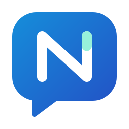
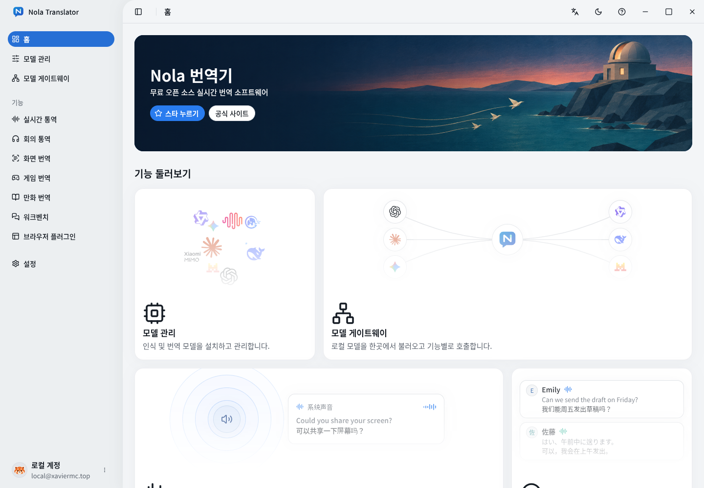
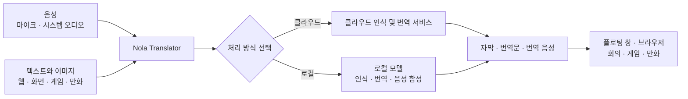

<div align="center">
  
  <h1>Nola Translator</h1>
  <p>브라우저 확장 프로그램을 제공하는 오픈소스 실시간 번역 소프트웨어</p>
  <p><a href="README.md">English</a> · <a href="README.zh-CN.md">简体中文</a> · <a href="README.zh-TW.md">繁體中文（台灣）</a> · <a href="README.zh-HK.md">繁體中文（香港）</a> · <a href="README.ja.md">日本語</a> · <a href="README.ko.md">한국어</a></p>
</div>

<p align="center">
  <a href="./LICENSE"></a>
  <a href="https://github.com/CerealAxis/Nola-Translator/actions/workflows/build.yml"></a>
  <a href="https://github.com/CerealAxis/Nola-Translator/actions/workflows/build.yml"></a>
  <a href="https://github.com/CerealAxis/Nola-Translator/releases"></a>
  <a href="https://github.com/CerealAxis/Nola-Translator/releases/latest"></a>
  
  
  
  
</p>

Nola Translator는 Windows 데스크톱과 브라우저를 지원하는 오픈소스 실시간 번역 애플리케이션입니다. 로컬 추론과 함께 Qwen, MiniMax, OpenAI 호환 API, Google Translate, Microsoft Translator, Index Translate 등의 클라우드 서비스를 이용할 수 있습니다. 실시간 자막, 회의 통역, 만화 번역 등의 기능을 제공합니다.

## 데모

<p align="center">
  <a href="https://nola.xaviermc.top/">
    
  </a>
</p>

> [!TIP]
> 온라인 데모를 경험하려면 클릭하세요

## 작동 방식



| | |
|---|---|
| **서비스 제공업체** | Alibaba Cloud, MiniMax, OpenAI, Gemini, Anthropic, DeepSeek, Google Translate, Microsoft Translator, OpenAI 호환 인터페이스, Anthropic, Ollama 등|
| **로컬 모델** | ASR 모델 26개, 번역 모델 17개, TTS 모델 16개, LLM 모델 3개, OCR 모델 17개, 만화 탐지 및 분류 모델 5개, 이미지 복원 모델 3개 |
| **언어** | 60+ (음성 인식) · 150+ (번역) · 29+ (음성 합성) |
| **플랫폼** | Windows x64 · Chrome · Edge · Firefox |
| **개인정보 보호** | 로컬 추론 = 기기에서 100% 실행, 클라우드 서비스 사용 시 관련 콘텐츠가 선택한 서비스 제공자에게 전송됩니다. |

> [!TIP]
> 소프트웨어가 지원하는 언어는 선택한 모델에 따라 결정됩니다. 모델에 따라 지원되는 언어 기능이 다를 수 있습니다. 자세한 내용은 소프트웨어의 구성을 참조하십시오.

## 설치

Nola는 **데스크톱 앱**과 **브라우저 확장 프로그램**을 제공합니다. 데스크톱 앱은 실시간 자막, 회의, 화면, 게임 및 만화를 지원합니다. 브라우저 확장 프로그램은 웹페이지와 동영상 자막을 번역하고 데스크톱 모델에 연결할 수 있습니다.

> [!TIP]
> 데스크톱에서의 회의 통역, 화면 번역, 게임 번역, 만화 번역 기능은 실험 중이며 개발 중입니다.

| | 데스크톱 앱 | 브라우저 확장 프로그램 |
|---|---|---|
| **기능** | 모델 게이트웨이, 실시간 자막, 회의 통역, 화면 번역, 게임 번역, 만화 번역, 워크벤치, 용어집 | 웹페이지 번역, 동영상 자막, 문서 번역, 서비스 구성, 용어집 |
| **사용 환경** | 컴퓨터 오디오, 회의 소프트웨어, 화면 콘텐츠, 게임 및 만화 | 웹페이지 및 동영상 |
| **설치 방법** | 설치 패키지 다운로드 | 확장 프로그램 다운로드 및 설치 |
| **플랫폼** | Windows x64 | Chrome · Edge · Firefox |

### 데스크톱 앱

- [GitHub Releases](https://github.com/CerealAxis/Nola-Translator/releases)
- [百度网盘](https://pan.baidu.com/s/1vq6wMwdJo_0FGo_lu6FfuA?pwd=kna2)
- [夸克网盘](https://pan.quark.cn/s/ef1e11262087)

### 브라우저 확장 프로그램

Nola 데스크톱 앱의 브라우저 설정에서 확장 프로그램을 다운로드하고 관리할 수 있습니다. 확장 프로그램에 번역 서비스를 별도로 설정할 수 있으며, 데스크톱 모델을 사용하려면 앱에서 브라우저 연결을 활성화하세요.

- [GitHub Releases](https://github.com/CerealAxis/Nola-Translator/releases)
- [百度网盘](https://pan.baidu.com/s/1vq6wMwdJo_0FGo_lu6FfuA?pwd=kna2)
- [夸克网盘](https://pan.quark.cn/s/ef1e11262087)

<details>
<summary>개발자 모드에서 확장 프로그램 설치</summary>

1. Nola의 브라우저 설정이나 프로젝트 게시 페이지에서 확장 프로그램을 다운로드하세요.
2. 확장 파일의 압축을 풉니다.
3. 브라우저에서 확장 프로그램 관리 페이지를 열고 개발자 모드를 활성화하세요.
4. "압축 해제된 확장 프로그램 로드"를 선택하고 압축 해제된 폴더를 선택합니다.

</details>

### 소스에서 빌드

개발 환경은 Node.js 24, npm 11 및 Python 3.12를 사용합니다.

```powershell
git clone https://github.com/CerealAxis/Nola-Translator.git
cd Nola-Translator
npm ci
npm run dev       # 개발
npm run build     # 데스크톱 앱 빌드
```

## 기능

### 로컬 추론

- **음성 인식**: 로컬 ASR 모델로 음성을 텍스트로 변환합니다.
- **텍스트 번역**: 로컬 번역 모델로 인식 결과와 텍스트를 번역합니다.
- **음성 합성**: 설정한 음성 합성 모델로 번역된 음성을 생성합니다.
- **모델 관리**: 필요에 따라 모델을 설치하고, 컴퓨팅 장치를 선택하고, 모델 게이트웨이에서 모델 기능 및 실행 상태를 관리합니다.

### 클라우드 서비스

| 서비스 또는 인터페이스 | 주요 목적 |
|---|---|
| **Alibaba Cloud LiveTranslate** | 엔드투엔드 음성 번역 |
| **Alibaba Cloud, MiniMax** | 클라우드 음성 인식 |
| **OpenAI 호환 인터페이스** | 번역 및 텍스트 처리를 위해 호환 가능한 클라우드 언어 모델에 액세스 |
| **Anthropic** | Anthropic Messages 프로토콜을 사용하여 모델에 액세스 |
| **Ollama** | Ollama 모델에 액세스 |
| **무료 번역 서비스** | Microsoft Translator, Google Translate, Index Translate 등 무료 번역 서비스를 사용합니다. |

### 오디오

- **실시간 통역**: 마이크, 시스템 오디오 또는 지정된 애플리케이션에서 소리를 수집하고 실시간 자막 및 번역을 생성합니다.
- **회의 통역**: 회의에서 양측의 연설을 번역하고, 설정한 오디오 장치를 통해 번역 음성을 재생하거나 전송합니다.
- **브라우저 자막**: 탭 오디오 또는 시스템 오디오를 사용하여 웹 동영상의 자막을 표시합니다.
- **플로팅 자막**: 자막을 별도의 창에 표시하고 원문, 번역, 모양을 조정합니다.
- **기록 및 내보내기**: 실시간 통역 기록 저장, 자막 내보내기, 요청 시 녹음 저장이 가능합니다.

### 인터페이스

- **다국어 인터페이스**: 중국어 간체, 중국어 번체, 영어, 일본어, 한국어를 지원하며, 시스템 언어도 따를 수 있습니다.
- **워크벤치**: 대화, 텍스트 처리 및 기타 모델 기능 호출을 위해 구성된 모델을 사용합니다.
- **화면 번역**: 화면이나 창의 텍스트 영역을 선택하면 번역된 내용이 원래 위치에 표시됩니다.
- **게임 번역**: OCR, Hook 또는 클립보드에서 게임 텍스트를 가져와서 플로팅 창을 통해 번역을 표시합니다.
- **만화 번역**: 만화를 가져와서 프로젝트에서 인식, 번역, 복원, 조판, 편집을 수행합니다.
- **용어집**: 용어를 관리하고 지원되는 번역 시나리오에 사용할 용어를 선택합니다.

## 기여하기

Issue와 Pull Request를 환영합니다. 시작하기 전에 [프로젝트 개발 규약](AGENTS.md)과 [디자인 규범](docs/design-system/DESIGN.md)을 참고하세요.

## 후원

Nola Translator의 후속 개발을 지원하려면 다음 방법으로 후원할 수 있습니다.

- [爱发电](https://afdian.com/a/CerealAxis)
- [GitHub Sponsors](https://github.com/sponsors/CerealAxis/)

## 도움말

- [Issues](https://github.com/CerealAxis/Nola-Translator/issues) — 문제 신고
- [Discussions](https://github.com/CerealAxis/Nola-Translator/discussions) — 질문하고 소통하세요.
- [도움말 문서](https://nola.xaviermc.top/ko/docs) — 도움말 문서

## 참고 프로젝트

| 프로젝트 | 라이선스 |
| --- | --- |
| [X-Translator](https://github.com/zhaoyx239/X-Translator) | [MIT](https://github.com/zhaoyx239/X-Translator#acknowledgements) |
| [FluentRead](https://github.com/FluentRead/FluentRead) | [GPL-3.0](https://github.com/FluentRead/FluentRead/blob/main/LICENSE) |
| [Sokuji](https://github.com/kizuna-ai-lab/sokuji) | [AGPL-3.0](https://github.com/kizuna-ai-lab/sokuji/blob/main/LICENSE) |
| [Lumina](https://github.com/lumina-tl/lumina) | [MIT](https://github.com/lumina-tl/lumina/blob/main/LICENSE) |
| [PhotoCraft](https://github.com/storytold/photocraft) | [MIT](https://github.com/storytold/photocraft/blob/main/LICENSE-MIT) 또는 [Apache-2.0](https://github.com/storytold/photocraft/blob/main/LICENSE-APACHE) |

## 라이선스

Nola Translator의 독창적인 소프트웨어 코드는 [GPL-3.0-only](LICENSE), 문서의 독창적인 내용은 [CC BY-SA 4.0](LICENSE-DOCUMENTATION)에 따라 제공됩니다.

프로젝트에서 사용하는 제3자 구성 요소, 모델, 글꼴, 아이콘 및 기타 리소스에는 각각의 라이선스가 적용됩니다. 저작권 및 라이선스 정보는 [제3자 고지](THIRD_PARTY_NOTICES.md)와 각 파일의 설명을 참고하세요.

Nola Translator의 이름, 워드마크 및 로고는 위 오픈소스 라이선스의 브랜드 사용 허가에 포함되지 않습니다. 사용 조건은 [브랜드 사용 고지](LICENSE-BRAND)를 참고하세요.

## Star History

[](https://star-history.com/#CerealAxis/Nola-Translator)
