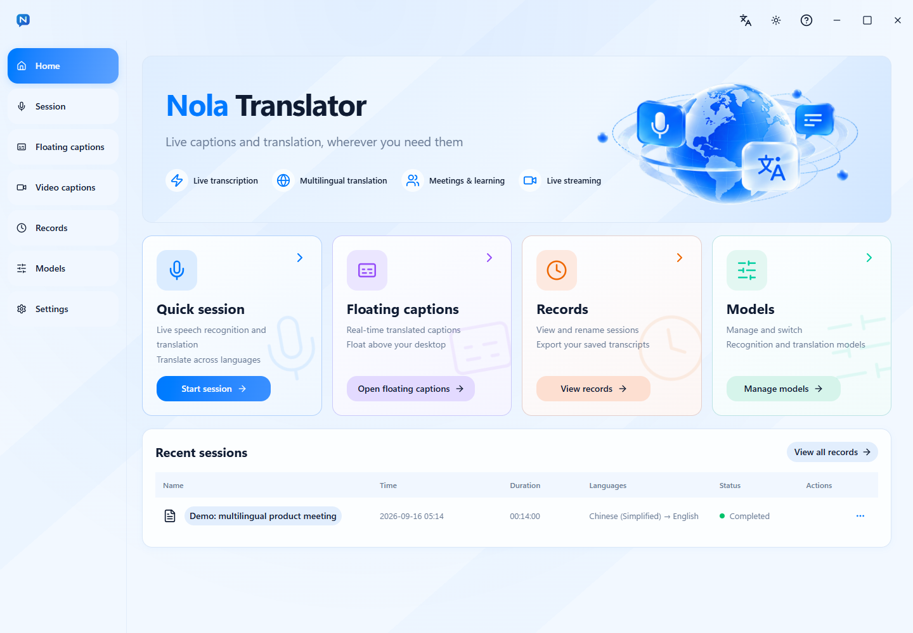
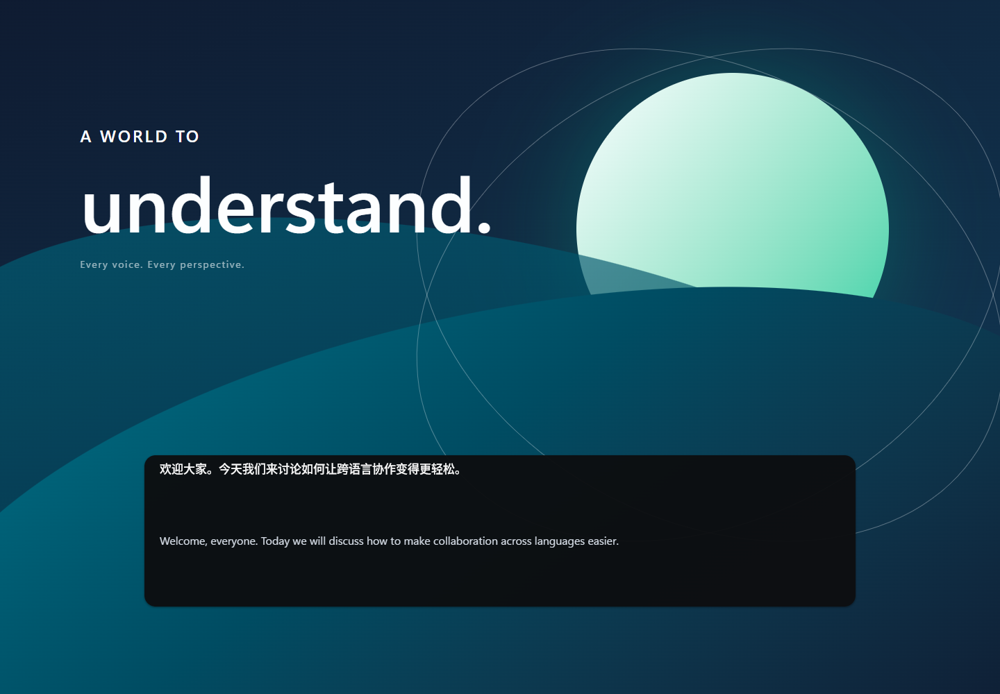
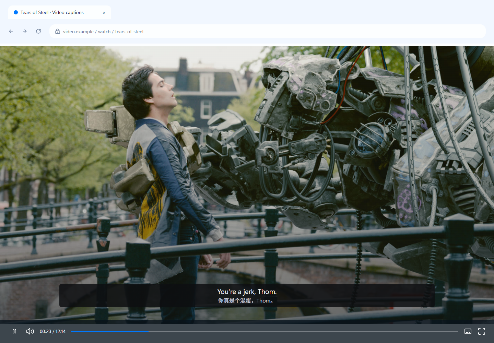
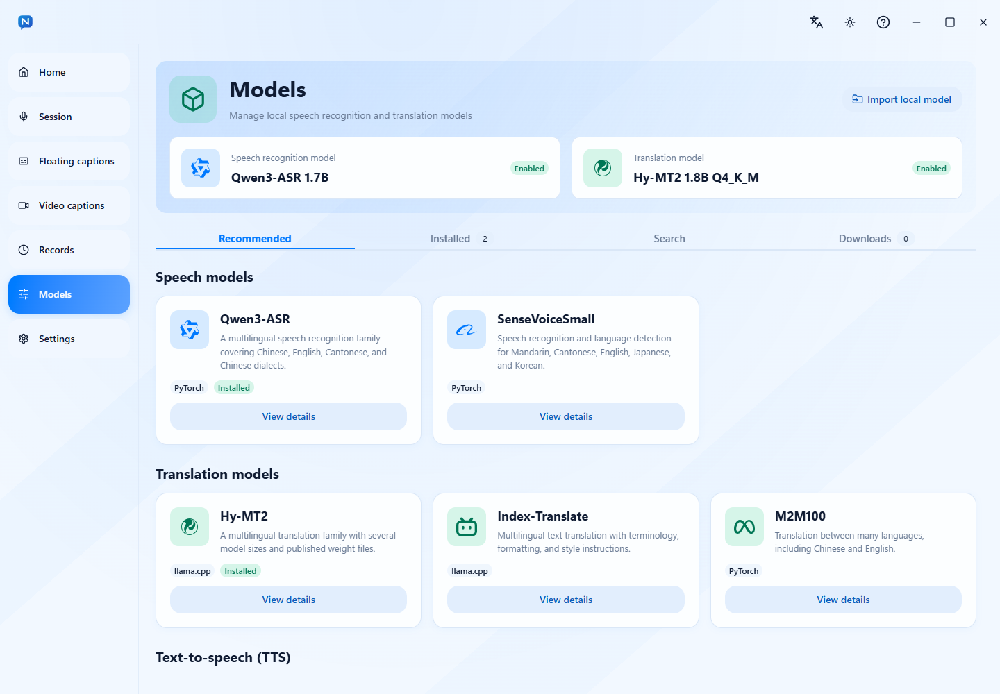

<div align="center">
  
  <h1>Nola Translator</h1>
  <p>A real-time captioning and translation app.</p>
  <p><a href="README.md">English</a> · <a href="README.zh-CN.md">简体中文</a> · <a href="README.zh-TW.md">繁體中文（台灣）</a> · <a href="README.zh-HK.md">繁體中文（香港）</a> · <a href="README.ja.md">日本語</a> · <a href="README.ko.md">한국어</a></p>
</div>

<p align="center">
  <a href="./LICENSE"></a>
  <a href="https://github.com/CerealAxis/Nola-Translator/actions/workflows/build.yml"></a>
  <a href="https://github.com/CerealAxis/Nola-Translator/actions/workflows/build.yml"></a>
  <a href="https://github.com/CerealAxis/Nola-Translator/releases"></a>
  <a href="https://github.com/CerealAxis/Nola-Translator/releases/latest"></a>
  
  
  
  
</p>

<p align="center">
  
</p>

## Overview

Nola Translator turns speech into real-time captions and translations. Run speech recognition and translation locally, use cloud services, or combine the two.

## Features

- **Local models:** Run recognition models such as Qwen3-ASR and SenseVoiceSmall, and translation models such as HY-MT2 locally. The app can also search for and install other models from Hugging Face.
- **Cloud models:** Use speech recognition from Aliyun, MiniMax, and other providers; connect translation models through LLM protocols such as OpenAI-compatible APIs, Anthropic, or Ollama; or use the free MyMemory translation service.
- **GPU acceleration:** Detects available compute devices and lets you configure separate devices for recognition and translation.
- **Browser extension:** Includes a browser extension for Chrome and Edge that displays bilingual captions on video pages. You can also configure desktop system audio as an input source.
- **Real-time caption overlay:** Supports system output, a selected audio device, or a microphone. Captions appear in a separate overlay, where you can adjust its position, font size, colors, opacity, and original/translated text layout.
- **Flexible configuration:** Install models as needed and choose recognition and translation methods, language directions, compute devices, and caption styles. API credentials are securely stored by the app.
- **History and export:** Save caption history and export it as TXT, SRT, or WebVTT. Audio recording can be enabled optionally.

## Interface Preview

| Home | Floating Captions | Video Captions |
|---|---|---|
|  |  |  |

| Local Model Installation | Inference Environment Settings | Dark Mode Support |
|---|---|---|
|  |  |  |

The floating and browser caption scenes use a cropped frame from [*Tears of Steel*](https://commons.wikimedia.org/wiki/File:Tears_of_Steel_frame_05_6a.jpg), © Blender Foundation, under [CC BY 3.0](https://creativecommons.org/licenses/by/3.0/).

## Installation

- [Download the latest release](https://github.com/CerealAxis/Nola-Translator/releases/latest)

Windows x64 is supported. You can choose the EXE or MSI installer. Support for other platforms is planned once development has stabilized.

- [Online documentation](https://nola.xaviermc.top/en/)

## Local Recognition Models

> [!TIP]
> The languages available for recognition and translation depend on the selected model's capabilities. The tables below show the capabilities of the recommended models included in the app. If you have a model to recommend, submit it as an issue; we will evaluate it for possible inclusion. For first-time users, we recommend **SenseVoiceSmall** for recognition and **HY-MT2** for translation.

| Model | Number of Languages | Details |
|---|---:|---|
| Qwen3-ASR | 30 | Chinese, English, Cantonese, Arabic, German, French, Spanish, Portuguese, Indonesian, Italian, Korean, Russian, Thai, Vietnamese, Japanese, Turkish, Hindi, Malay, Dutch, Swedish, Danish, Finnish, Polish, Czech, Filipino, Persian, Greek, Hungarian, Macedonian, and Romanian |
| SenseVoiceSmall | 5 | Chinese, English, Cantonese, Japanese, and Korean |
| Fun-ASR Nano | 4 | Chinese, English, Japanese, and Cantonese |
| VibeVoice-ASR | 48 | English, Chinese, Spanish, Portuguese, German, Japanese, Korean, French, Russian, Indonesian, Swedish, Italian, Hebrew, Dutch, Polish, Norwegian, Turkish, Thai, Arabic, Hungarian, Catalan, Czech, Danish, Persian, Afrikaans, Hindi, Finnish, Estonian, Greek, Romanian, Vietnamese, Bulgarian, Icelandic, Slovenian, Slovak, Lithuanian, Swahili, Ukrainian, Latvian, Croatian, Nepali, Serbian, Filipino, Malay, Urdu, Mongolian, Armenian, and Javanese |
| MiMo-V2.5-ASR | 3 | Chinese, English, and Cantonese |

## Local Translation Models

| Model | Number of Languages | Details |
|---|---:|---|
| HY-MT2 | 38 | Simplified Chinese, Traditional Chinese, English, French, Portuguese, Spanish, Japanese, Turkish, Russian, Arabic, Korean, Thai, Italian, German, Vietnamese, Malay, Indonesian, Filipino, Hindi, Polish, Czech, Dutch, Khmer, Burmese, Persian, Gujarati, Urdu, Telugu, Marathi, Hebrew, Bengali, Tamil, Ukrainian, Tibetan, Kazakh, Mongolian, Uyghur, and Cantonese |
| M2M100 418M | 100 | Afrikaans, Amharic, Arabic, Asturian, Azerbaijani, Bashkir, Belarusian, Bulgarian, Bengali, Breton, Bosnian, Catalan, Cebuano, Czech, Welsh, Danish, German, Greek, English, Spanish, Estonian, Persian, Fula, Finnish, French, Western Frisian, Irish, Scottish Gaelic, Galician, Gujarati, Hausa, Hebrew, Hindi, Croatian, Haitian Creole, Hungarian, Armenian, Indonesian, Igbo, Ilocano, Icelandic, Italian, Japanese, Javanese, Georgian, Kazakh, Khmer, Kannada, Korean, Luxembourgish, Ganda (Luganda), Lingala, Lao, Lithuanian, Latvian, Malagasy, Macedonian, Malayalam, Mongolian, Marathi, Malay, Burmese, Nepali, Dutch, Norwegian, Northern Sotho, Occitan, Odia, Punjabi, Polish, Pashto, Portuguese, Romanian, Russian, Sindhi, Sinhala, Slovak, Slovenian, Somali, Albanian, Serbian, Swati, Sundanese, Swedish, Swahili, Tamil, Thai, Filipino, Tswana, Turkish, Ukrainian, Urdu, Uzbek, Vietnamese, Wolof, Xhosa, Yiddish, Yoruba, Chinese, and Zulu |
| Index-Translate | 150 | English, Chinese, German, French, Spanish, Japanese, Korean, Portuguese, Russian, Arabic, Italian, Dutch, Polish, Romanian, Swedish, Turkish, Hindi, Vietnamese, Thai, Indonesian, Malay, Filipino, Ukrainian, Persian, Czech, Greek, Danish, Hungarian, Finnish, Norwegian (written), Slovak, Bulgarian, Bosnian, Catalan, Bengali, Hebrew, Lithuanian, Slovenian, Estonian, Albanian, Latvian, Azerbaijani, Croatian, Tamil, Nepali, Urdu, Macedonian, Serbian (Cyrillic), Marathi, Georgian, Malayalam, Kazakh, Icelandic, Galician, Kannada, Moroccan Arabic, Gujarati, Belarusian, Afrikaans, Armenian, Mongolian, Khmer, Basque, Burmese, Latin, Uzbek (Cyrillic), Telugu, Odia, Norwegian Nynorsk, Uzbek, Swahili, Sinhala, Kyrgyz, Somali, Punjabi, Egyptian Arabic, Welsh, Norman, Pashto, Irish, Serbian (Latin), Hausa, Kurdish (Sorani), Maltese, Cantonese, Tajik, Kurdish (Kurmanji), Betawi, Amharic, Lao, Luxembourgish, Frisian, Divehi, Esperanto, Kinyarwanda, Najdi Arabic, Faroese, Malagasy, Assamese, Sindhi, Xhosa, Turkmen, Haitian Creole, Scottish Gaelic, Cebuano, Yiddish, Javanese, Bashkir, Papiamento, Maori, Uyghur, Tatar, Tibetan, Hmong, Western Armenian, Yoruba, Zulu, Southern Kurdish, Samoan, Corsican, Fiji Hindi, Sundanese, Chichewa, Igbo, Hawaiian, Sesotho, Mizo, Shona, Chuvash, South Azerbaijani, Romansh, Rundi, Hindi (Latin), Sakha, Tigrinya, Asturian, Occitan, Hakha Chin, Northern Sami, Low German, Ossetian, Urdu (Latin), Swiss German, Angika, Levantine Arabic, Oromo, Neapolitan, Upper Sorbian, Hiligaynon, and Greenlandic |

## Local Text-to-Speech

| Model | Number of Languages | Details |
|---|---:|---|
| Qwen3-TTS | 10 | Chinese, English, Japanese, Korean, German, French, Russian, Portuguese, Spanish, and Italian |

## Cloud Recognition Models

| Provider | Model | Supported languages | Details |
|---|---|---|---|
| Aliyun | Qwen3.5 / Qwen3.8 LiveTranslate | 60 | Chinese, English, Arabic, German, French, Spanish, Portuguese, Indonesian, Italian, Korean, Russian, Thai, Vietnamese, Japanese, Turkish, Hindi, Malay, Dutch, Urdu, Norwegian Bokmål, Swedish, Danish, Hebrew, Finnish, Polish, Icelandic, Czech, Filipino, Persian, Cantonese, Greek, Afrikaans, Asturian, Belarusian, Bulgarian, Bengali, Bosnian, Catalan, Cebuano, Estonian, Galician, Gujarati, Croatian, Hungarian, Javanese, Kazakh, Kannada, Kyrgyz, Latvian, Macedonian, Malayalam, Marathi, Punjabi, Romanian, Slovak, Slovenian, Swahili, Tajik, Azerbaijani, and Ukrainian. Version 3.8 detects the source language automatically; version 3.5 allows you to specify the source language. |
| MiniMax | Speech-to-Text `asr-1.0` | 20 | Arabic, Cantonese, Chinese, English, Filipino, French, German, Indonesian, Italian, Japanese, Korean, Malay, Polish, Portuguese, Russian, Spanish, Thai, Turkish, Ukrainian, and Vietnamese. |

## Cloud Translation Models

| Model | Number of Languages | Details |
|---|---:|---|
| Aliyun LiveTranslate | 60 | Automatic source-language detection |
| Index-Translate-35B-A3B | 150 | English, Chinese, German, French, Spanish, Japanese, Korean, Portuguese, Russian, Arabic, Italian, Dutch, Polish, Romanian, Swedish, Turkish, Hindi, Vietnamese, Thai, Indonesian, Malay, Filipino, Ukrainian, Persian, Czech, Greek, Danish, Hungarian, Finnish, Norwegian (written), Slovak, Bulgarian, Bosnian, Catalan, Bengali, Hebrew, Lithuanian, Slovenian, Estonian, Albanian, Latvian, Azerbaijani, Croatian, Tamil, Nepali, Urdu, Macedonian, Serbian (Cyrillic), Marathi, Georgian, Malayalam, Kazakh, Icelandic, Galician, Kannada, Moroccan Arabic, Gujarati, Belarusian, Afrikaans, Armenian, Mongolian, Khmer, Basque, Burmese, Latin, Uzbek (Cyrillic), Telugu, Odia, Norwegian Nynorsk, Uzbek, Swahili, Sinhala, Kyrgyz, Somali, Punjabi, Egyptian Arabic, Welsh, Norman, Pashto, Irish, Serbian (Latin), Hausa, Kurdish (Sorani), Maltese, Cantonese, Tajik, Kurdish (Kurmanji), Betawi, Amharic, Lao, Luxembourgish, Frisian, Divehi, Esperanto, Kinyarwanda, Najdi Arabic, Faroese, Malagasy, Assamese, Sindhi, Xhosa, Turkmen, Haitian Creole, Scottish Gaelic, Cebuano, Yiddish, Javanese, Bashkir, Papiamento, Maori, Uyghur, Tatar, Tibetan, Hmong, Western Armenian, Yoruba, Zulu, Southern Kurdish, Samoan, Corsican, Fiji Hindi, Sundanese, Chichewa, Igbo, Hawaiian, Sesotho, Mizo, Shona, Chuvash, South Azerbaijani, Romansh, Rundi, Hindi (Latin), Sakha, Tigrinya, Asturian, Occitan, Hakha Chin, Northern Sami, Low German, Ossetian, Urdu (Latin), Swiss German, Angika, Levantine Arabic, Oromo, Neapolitan, Upper Sorbian, Hiligaynon, and Greenlandic |
| Microsoft Translator | 100+ | Per the official language table |
| Google Translate | 100+ | Per the official language table |
| MyMemory (free translation) | 100+ | Per the official language table |
| LLM API (OpenAI-compatible, Anthropic, Ollama) | Depends on the chosen model | — |

## LLM API Configuration

> [!TIP]
> The LLM protocols here are used for translation. Aliyun and MiniMax ASR models use separate connection settings and credentials under Audio and Recognition. Local models require no API configuration.

### Supported Protocols

The app supports the following API protocols:

| Protocol |
|---|
| OpenAI Chat Completions |
| OpenAI Responses |
| Anthropic Messages |
| Ollama Chat |

### Configuration Examples

| Provider | API Format | Example API URL | Example Model ID |
|---|---|---|---|
| DeepSeek | OpenAI Chat Completions | `https://api.deepseek.com` | `deepseek-flash` |
| MiniMax | OpenAI Chat Completions | `https://api.minimax.io/v1` | `MiniMax-M3` |
| MiMo | OpenAI Chat Completions | `https://api.xiaomimimo.com/v1` | `mimo-v2.6-pro` |

### Configuration Steps


1. Select **Cloud Translation** in the translation settings.
2. Choose the **API format** supported by your provider.
3. Enter the **API URL**, **API key**, and **model ID**.
4. Adjust the context window and maximum output tokens as needed.

## Project Structure

```text
assets/brand/                  Logo and brand assets
docs/                          VitePress product website and multilingual documentation
engine/nola_translator_engine/  Python audio, recognition, and translation engine
engine/tests/                   Python tests
scripts/                        Setup and build scripts
src/main/                       Electron main process
src/preload/                    IPC bridge
src/renderer/                   React interface
src/shared/                     Shared contracts and settings
tests/                          Application tests
```

## Development and Build

```powershell
npm run typecheck
npm test
.\.venv\Scripts\python.exe -m pytest engine\tests
npm run build
```

Build the Windows x64 installer:

```powershell
npm run dist:win
```

## Contributing

Fork the repository, create a branch, make your changes, and open a pull request. Briefly describe your changes and the checks you ran. For design and code conventions, see [DESIGN.md](DESIGN.md) and the [contribution guide](https://nola.xaviermc.top/en/contributing/).

## Sponsorship

You can support this project through the channels below. Sponsors receive benefits including priority help with issues, one-on-one guidance, permanent recognition in the sponsor list and in the app, and custom features.

**1. Mainland China**
- [Afdian](https://afdian.com/a/CerealAxis)

**2. Other regions**
- [GitHub Sponsors](https://github.com/sponsors/CerealAxis/)

## License

Nola Translator's original code is licensed under [GNU GPL v3.0 only](LICENSE). Third-party components and models are subject to their respective licenses; see [Third-Party Notices](THIRD_PARTY_NOTICES.md).

[](https://star-history.com/#CerealAxis/Nola-Translator)
