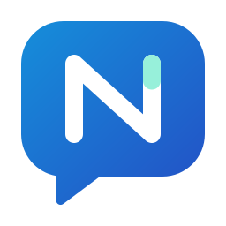
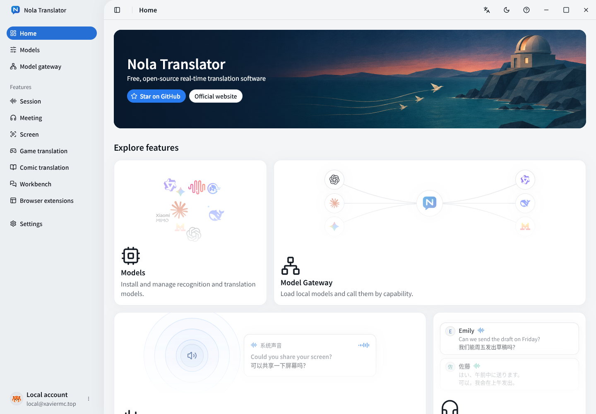
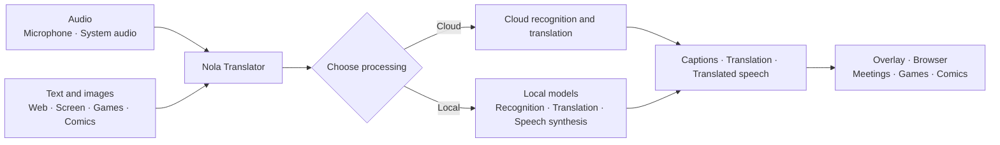

<div align="center">
  
  <h1>Nola Translator</h1>
  <p>Open-source real-time translation for desktop and browser</p>
  <p><a href="README.md">English</a> · <a href="README.zh-CN.md">简体中文</a> · <a href="README.zh-TW.md">繁體中文（台灣）</a> · <a href="README.zh-HK.md">繁體中文（香港）</a> · <a href="README.ja.md">日本語</a> · <a href="README.ko.md">한국어</a></p>
</div>

<p align="center">
  <a href="./LICENSE"></a>
  <a href="https://github.com/CerealAxis/Nola-Translator/actions/workflows/build.yml"></a>
  <a href="https://github.com/CerealAxis/Nola-Translator/actions/workflows/build.yml"></a>
  <a href="https://github.com/CerealAxis/Nola-Translator/releases"></a>
  <a href="https://github.com/CerealAxis/Nola-Translator/releases/latest"></a>
  
  
  
  
</p>

Nola Translator is a cross-platform real-time translation application for Windows and browsers. It supports local inference and cloud providers including Qwen, MiniMax, OpenAI-compatible APIs, Google Translate, Microsoft Translator and Index Translate. Features include live captions, meeting interpretation and comic translation.

## Demo

<p align="center">
  <a href="https://nolax.org/">
    
  </a>
</p>

> [!TIP]
> Click to experience the online demo

## How It Works



| | |
|---|---|
| **Providers** | Alibaba Cloud, MiniMax, OpenAI, Gemini, Anthropic, DeepSeek, Google Translate, Microsoft Translator, OpenAI compatible interface, Anthropic, Ollama, etc.|
| **Local Models** | 26 ASR models, 17 translation models, 16 TTS models, 3 LLM models, 17 OCR models, 5 comic detection and classification models, 3 image restoration models |
| **Languages** | 60+ (speech recognition) · 150+ (translation) · 29+ (speech synthesis) |
| **Platforms** | Windows x64 · Chrome · Edge · Firefox |
| **Privacy** | Local inference runs entirely on your device; cloud services receive the relevant content when selected. |

> [!TIP]
> Available languages depend on the model you select. Check the configuration in the application for details.

## Installation

Nola provides a **desktop application** and a **browser extension**. The desktop application covers live captions, meetings, screens, games and comics. The browser extension translates web pages and video subtitles and can connect to desktop models.

> [!TIP]
> The conference interpretation, screen translation, game translation, and comic translation functions on the desktop are experimental and are under development.

| | Desktop application | Browser extension |
|---|---|---|
| **Features** | Model Gateway, Live Subtitles, Conference Interpretation, Screen Translation, Game Translation, Comic Translation, Workbench, Glossary | Web page translation, video subtitles, document translation, service configuration, glossary |
| **Use cases** | Computer audio, conferencing software, screen content, games and comics | Web pages and videos |
| **Installation** | Download the installation package | Download and install the extension |
| **Platforms** | Windows x64 | Chrome · Edge · Firefox |

### Desktop Application

- [GitHub Releases](https://github.com/CerealAxis/Nola-Translator/releases)
- [Baidu Netdisk](https://pan.baidu.com/s/1vq6wMwdJo_0FGo_lu6FfuA?pwd=kna2)
- [Quark Drive](https://pan.quark.cn/s/ef1e11262087)

### Browser Extension

Download and manage the extension in the Nola desktop browser settings. The extension can be configured with its own translation service; enable the browser connection in the desktop app to use desktop models.

- [GitHub Releases](https://github.com/CerealAxis/Nola-Translator/releases)
- [Baidu Netdisk](https://pan.baidu.com/s/1vq6wMwdJo_0FGo_lu6FfuA?pwd=kna2)
- [Quark Drive](https://pan.quark.cn/s/ef1e11262087)

<details>
<summary>Install the extension in developer mode</summary>

1. Download the extension from Nola browser settings or the project releases page.
2. Extract the extension archive.
3. Open the extension management page in your browser and enable developer mode.
4. Select “Load unpacked” and choose the extracted folder.

</details>

### Build from source

The development environment uses Node.js 24, npm 11 and Python 3.12.

```powershell
git clone https://github.com/CerealAxis/Nola-Translator.git
cd Nola-Translator
npm ci
npm run dev       # development
npm run build     # build desktop application
```

## Features

### Local Inference

- **Speech Recognition**: Convert audio to text with a local ASR model.
- **Text Translation**: Translate recognition results and other text with a local model.
- **Speech Synthesis**: Generate translated speech with a configured speech synthesis model.
- **Model Management**: Install models on demand, select computing devices, and manage model capabilities and running status in the model gateway.

### Cloud Services

| Service or API | Purpose |
|---|---|
| **Alibaba Cloud LiveTranslate** | End-to-end speech translation |
| **Alibaba Cloud, MiniMax** | Cloud speech recognition |
| **OpenAI compatible interface** | Access compatible cloud language models for translation and text processing |
| **Anthropic** | Access models using the Anthropic Messages protocol |
| **Ollama** | Access the Ollama model |
| **Free translation service** | Use free translation services provided by the application, including Microsoft Translator, Google Translate and Index Translate. |

### Audio

- **Quick Interpretation**: Capture microphone, system or selected application audio to generate live captions and translations.
- **Meeting Interpretation**: Translate both sides of a meeting and play or send translated speech through configured audio devices.
- **Browser Captions**: Show captions for web videos using tab or system audio.
- **Floating Captions**: Display captions in a separate window and adjust the original text, translation and appearance.
- **History and Export**: Save interpretation history, export subtitles and optionally save audio recordings.

### Interface

- **Multilingual Interface**: Supports Simplified Chinese, Traditional Chinese, English, Japanese and Korean, and can also follow the system language.
- **Workbench**: Use configured models for conversation, text processing and other capabilities.
- **Screen Translation**: Select text on a screen or window and display the translation in place.
- **Game Translation**: Capture game text through OCR, Hook or the clipboard and display translations in a floating window.
- **Comic Translation**: Import comics and recognize, translate, inpaint, typeset and edit them in a project.
- **Glossary**: Manage terminology and select a glossary in supported translation scenarios.

## Contributing

Issues and pull requests are welcome. Before getting started, see the [project engineering guidelines](AGENTS.md) and [design guidelines](docs/design-system/DESIGN.md).

## Sponsorship

Support the development of Nola Translator through:

- [Afdian](https://afdian.com/a/CerealAxis)
- [GitHub Sponsors](https://github.com/sponsors/CerealAxis/)

## Support

- [Issues](https://github.com/CerealAxis/Nola-Translator/issues) — Report a problem
- [Discussions](https://github.com/CerealAxis/Nola-Translator/discussions) — Questions and discussion
- [Documentation](https://nolax.org/en/docs) — Documentation

## Reference Projects

| Project | License |
| --- | --- |
| [X-Translator](https://github.com/zhaoyx239/X-Translator) | [MIT](https://github.com/zhaoyx239/X-Translator#acknowledgements) |
| [FluentRead](https://github.com/FluentRead/FluentRead) | [GPL-3.0](https://github.com/FluentRead/FluentRead/blob/main/LICENSE) |
| [Sokuji](https://github.com/kizuna-ai-lab/sokuji) | [AGPL-3.0](https://github.com/kizuna-ai-lab/sokuji/blob/main/LICENSE) |
| [Lumina](https://github.com/lumina-tl/lumina) | [MIT](https://github.com/lumina-tl/lumina/blob/main/LICENSE) |
| [PhotoCraft](https://github.com/storytold/photocraft) | [MIT](https://github.com/storytold/photocraft/blob/main/LICENSE-MIT) or [Apache-2.0](https://github.com/storytold/photocraft/blob/main/LICENSE-APACHE) |

## License

Nola Translator’s original software code is licensed under [GPL-3.0-only](LICENSE); original documentation is licensed under [CC BY-SA 4.0](LICENSE-DOCUMENTATION).

Third-party components, models, fonts, icons and other assets retain their respective licenses. See [Third-Party Notices](THIRD_PARTY_NOTICES.md) and the relevant files for copyright and license information.

The Nola Translator name, wordmark and logos are not covered by the brand permissions of these open-source licenses. See the [brand usage notice](LICENSE-BRAND) for terms of use.

## Star History

[](https://star-history.com/#CerealAxis/Nola-Translator)
