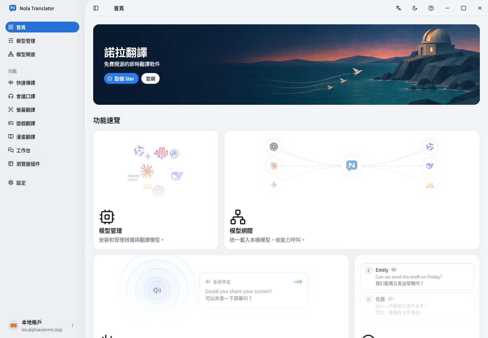
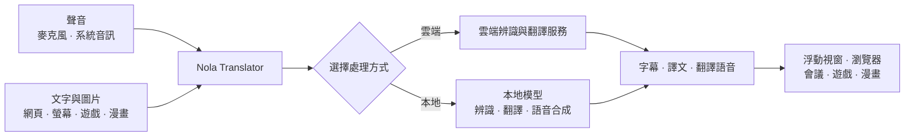

<div align="center">
  
  <h1>Nola Translator</h1>
  <p>一款開源的即時翻譯軟件，提供瀏覽器插件版本</p>
  <p><a href="README.md">English</a> · <a href="README.zh-CN.md">简体中文</a> · <a href="README.zh-TW.md">繁體中文（台灣）</a> · <a href="README.zh-HK.md">繁體中文（香港）</a> · <a href="README.ja.md">日本語</a> · <a href="README.ko.md">한국어</a></p>
</div>

<p align="center">
  <a href="./LICENSE"></a>
  <a href="https://github.com/CerealAxis/Nola-Translator/actions/workflows/build.yml"></a>
  <a href="https://github.com/CerealAxis/Nola-Translator/actions/workflows/build.yml"></a>
  <a href="https://github.com/CerealAxis/Nola-Translator/releases"></a>
  <a href="https://github.com/CerealAxis/Nola-Translator/releases/latest"></a>
  
  
  
  
</p>

Nola Translator 是一款跨平台即時翻譯應用，支援 Windows 桌面端和瀏覽器端；支援本地推理；同時可以接取千問、MiniMax、OpenAI 相容介面、Google 翻譯、微軟翻譯、Index Translate 等雲端服務商。提供即時字幕、會議口譯、漫畫翻譯等功能。

## 示範

<p align="center">
  <a href="https://nola.xaviermc.top/">
    
  </a>
</p>

> [!TIP]
> 點擊體驗線上演示

## 運作方式



| | |
|---|---|
| **服務商** | 阿里雲、MiniMax、OpenAI、Gemini、Anthropic、DeepSeek、Google 翻譯、Microsoft Translator、OpenAI 相容介面、Anthropic、Ollama 等|
| **本地模型** | 26 個 ASR 模型、17 個翻譯模型、16 個 TTS 模型、3 個 LLM 模型、17 個 OCR 模型、5 個漫畫偵測與分類模型、3 個影像修復模型 |
| **語言** | 60+（語音辨識）· 150+（翻譯）· 29+（語音合成） |
| **平台** | Windows x64 · Chrome · Edge · Firefox |
| **隱私** | 本地推理 = 100% 裝置端運行，使用雲端服務時，相關內容會傳送給所選服務商 |

> [!TIP]
> 軟件支援的語言由所選的模型決定，不同模型支援的語言能力可能不同，具體請以軟件中的配置為準

## 安裝

Nola 提供**桌面應用程式**和**瀏覽器擴充功能**。桌面端涵蓋即時字幕、會議、螢幕、遊戲和漫畫等場景；瀏覽器擴充功能提供網頁翻譯與影片字幕，並可連接桌面端呼叫模型能力。

> [!TIP]
> 桌面端的會議口譯、螢幕翻譯、遊戲翻譯、漫畫翻譯功能為實驗性功能，正在開發中

| | 桌面應用程式 | 瀏覽器擴充功能 |
|---|---|---|
| **功能** | 模型閘道、即時字幕、會議口譯、螢幕翻譯、遊戲翻譯、漫畫翻譯、工作台、術語庫 | 網頁翻譯、影片字幕、文件翻譯、服務設定、術語庫 |
| **使用場景** | 電腦音訊、會議軟件、螢幕內容、遊戲和漫畫 | 網頁及影片 |
| **安裝方式** | 下載安裝包 | 下載並安裝擴充功能 |
| **平台** | Windows x64 | Chrome · Edge · Firefox |

### 桌面應用程式

- [GitHub Releases](https://github.com/CerealAxis/Nola-Translator/releases)
- [百度網盤](https://pan.baidu.com/s/1vq6wMwdJo_0FGo_lu6FfuA?pwd=kna2)
- [夸克網盤](https://pan.quark.cn/s/ef1e11262087)

### 瀏覽器擴充功能

在 Nola 桌面端的瀏覽器設定中下載和管理擴充功能。擴充功能可以單獨配置翻譯服務；如需呼叫桌面端模型，請在軟件中啟用瀏覽器連線。

- [GitHub Releases](https://github.com/CerealAxis/Nola-Translator/releases)
- [百度網盤](https://pan.baidu.com/s/1vq6wMwdJo_0FGo_lu6FfuA?pwd=kna2)
- [夸克網盤](https://pan.quark.cn/s/ef1e11262087)

<details>
<summary>在開發者模式下安裝擴展</summary>

1. 從 Nola 的瀏覽器設定或專案發布頁下載擴充功能。
2. 解壓縮擴充檔。
3. 在瀏覽器中開啟擴充管理頁面，並啟用開發者模式。
4. 選擇“載入已解壓縮的擴充功能”，選擇解壓縮後的資料夾。

</details>

### 從源碼構建

開發環境使用 Node.js 24、npm 11 和 Python 3.12。

```powershell
git clone https://github.com/CerealAxis/Nola-Translator.git
cd Nola-Translator
npm ci
npm run dev       # 開發
npm run build     # 建置桌面應用程式
```

## 功能

### 本地推理

- **語音辨識**：使用本地 ASR 模型，將音訊轉換為文字。
- **文字翻譯**：使用本地翻譯模型處理辨識結果和其他文字。
- **語音合成**：使用已配置的語音合成模型產生譯音。
- **模型管理**：按需安裝模型，選擇運算設備，並在模型閘道中管理模型能力和運作狀態。

### 雲端服務

| 服務或介面 | 主要用途 |
|---|---|
| **阿里雲 LiveTranslate** | 端對端語音翻譯 |
| **阿里雲、MiniMax** | 雲端語音辨識 |
| **OpenAI 相容介面** | 存取相容的雲端語言模型，用於翻譯和文字處理 |
| **Anthropic** | 接入使用 Anthropic Messages 協定的模型 |
| **Ollama** | 接入 Ollama 模型 |
| **免費翻譯服務** | 使用應用程式提供的免費翻譯服務，如微軟翻譯、Google 翻譯、Index Translate 等 |

### 音訊

- **快速口譯**：採集麥克風、系統音訊或指定應用的聲音，產生即時字幕和譯文。
- **會議口譯**：翻譯會議雙方發言，透過配置的音訊設備播放或發送譯音。
- **瀏覽器字幕**：使用標籤頁音訊或系統音訊，為網頁影片顯示字幕。
- **懸浮字幕**：在獨立視窗中顯示字幕，調整原文、譯文和外觀。
- **記錄與匯出**：儲存口譯記錄，匯出字幕，並按需儲存錄音。

### 介面

- **多語言介面**：支援簡體中文、繁體中文、英文、日文和韓語，也可跟隨系統語言。
- **工作台**：使用已配置的模型進行對話、文字處理和其他模型能力呼叫。
- **螢幕翻譯**：選擇螢幕或視窗中的文字區域，在原始位置顯示譯文。
- **遊戲翻譯**：從 OCR、Hook 或剪貼簿取得遊戲文本，透過浮窗顯示譯文。
- **漫畫翻譯**：導入漫畫，在工程中進行辨識、翻譯、修復、排版和編輯。
- **術語庫**：管理術語，並在支援的翻譯場景中選擇使用。

## 參與貢獻

歡迎提交 Issue 和 Pull Request。開始之前，請參閱[專案工程規範](AGENTS.md)與[設計規範](docs/design-system/DESIGN.md)。

## 贊助

如果你希望支持 Nola Translator 的後續開發，可以透過以下方式贊助：

- [愛發電](https://afdian.com/a/CerealAxis)
- [GitHub Sponsors](https://github.com/sponsors/CerealAxis/)

## 獲取協助

- [Issues](https://github.com/CerealAxis/Nola-Translator/issues) — 報告問題
- [Discussions](https://github.com/CerealAxis/Nola-Translator/discussions) — 提問與交流
- [幫助文檔](https://nola.xaviermc.top/zh-HK/docs) — 幫助文檔

## 參考專案

| 專案 | 許可證 |
| --- | --- |
| [X-Translator](https://github.com/zhaoyx239/X-Translator) | [MIT](https://github.com/zhaoyx239/X-Translator#acknowledgements) |
| [流暢閱讀（FluentRead）](https://github.com/FluentRead/FluentRead) | [GPL-3.0](https://github.com/FluentRead/FluentRead/blob/main/LICENSE) |
| [Sokuji](https://github.com/kizuna-ai-lab/sokuji) | [AGPL-3.0](https://github.com/kizuna-ai-lab/sokuji/blob/main/LICENSE) |
| [Lumina](https://github.com/lumina-tl/lumina) | [MIT](https://github.com/lumina-tl/lumina/blob/main/LICENSE) |
| [PhotoCraft](https://github.com/storytold/photocraft) | [MIT](https://github.com/storytold/photocraft/blob/main/LICENSE-MIT) 或 [Apache-2.0](https://github.com/storytold/photocraft/blob/main/LICENSE-APACHE) |

## 授權條款

Nola Translator 的原創軟件程式碼採用 [GPL-3.0-only](LICENSE)，文件中的原創內容採用 [CC BY-SA 4.0](LICENSE-DOCUMENTATION)。

專案使用的第三方元件、模型、字型、圖示及其他資源遵循各自的授權條款。相關版權和授權資訊請參閱[第三方元件聲明](THIRD_PARTY_NOTICES.md)及對應檔案中的說明。

Nola Translator 的名稱、文字標誌及品牌標誌不在上述開源授權的品牌使用許可範圍內。使用條件請參閱[品牌使用聲明](LICENSE-BRAND)。

## Star History

[](https://star-history.com/#CerealAxis/Nola-Translator)
