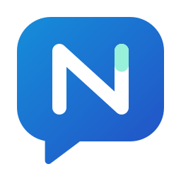
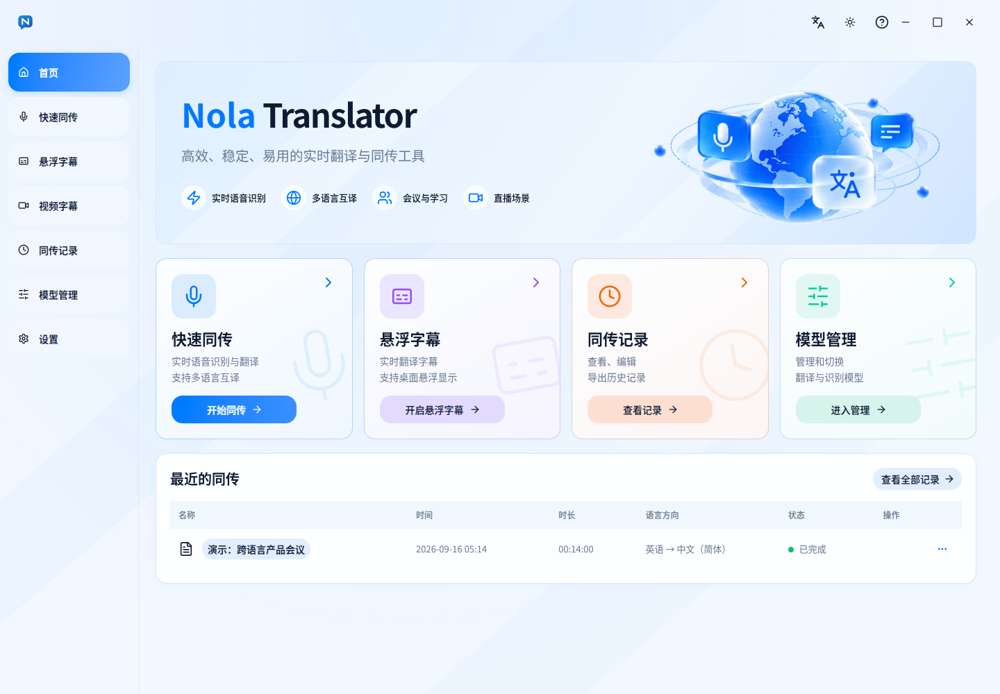
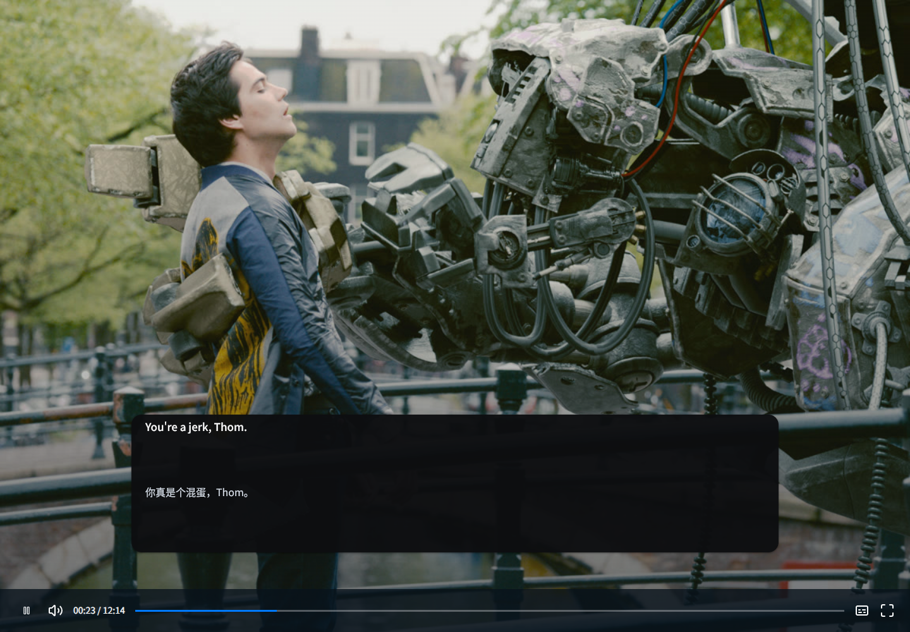
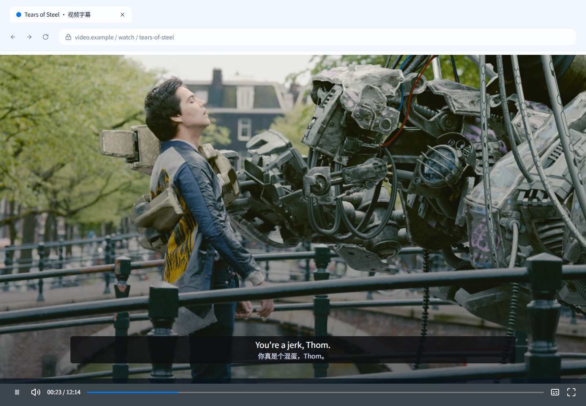
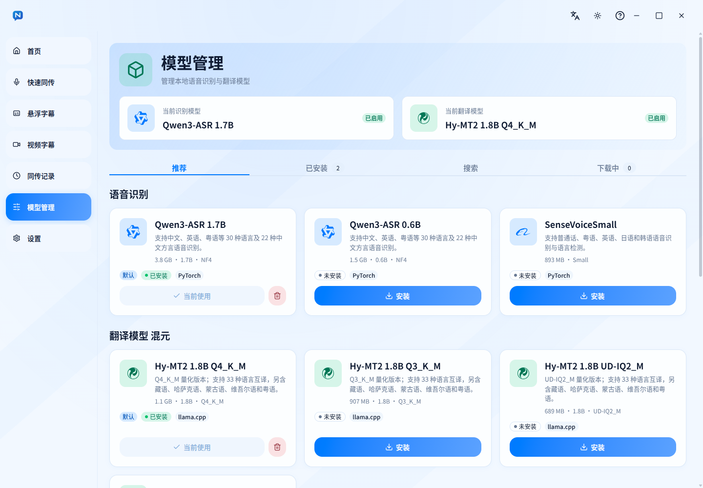
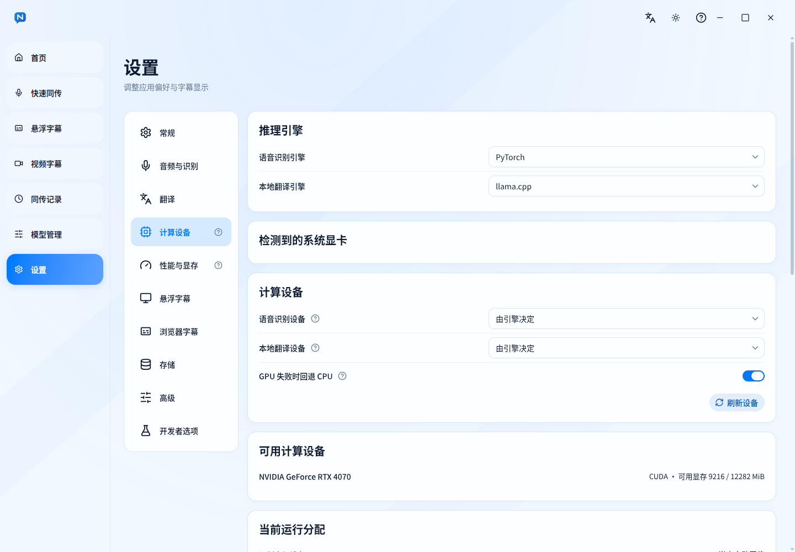
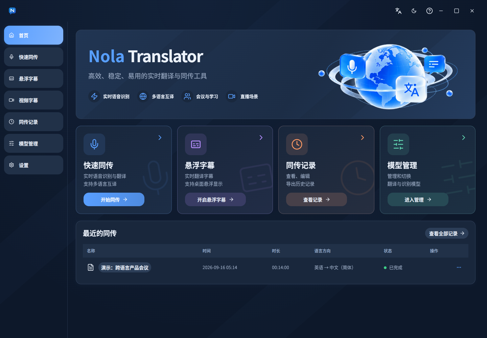
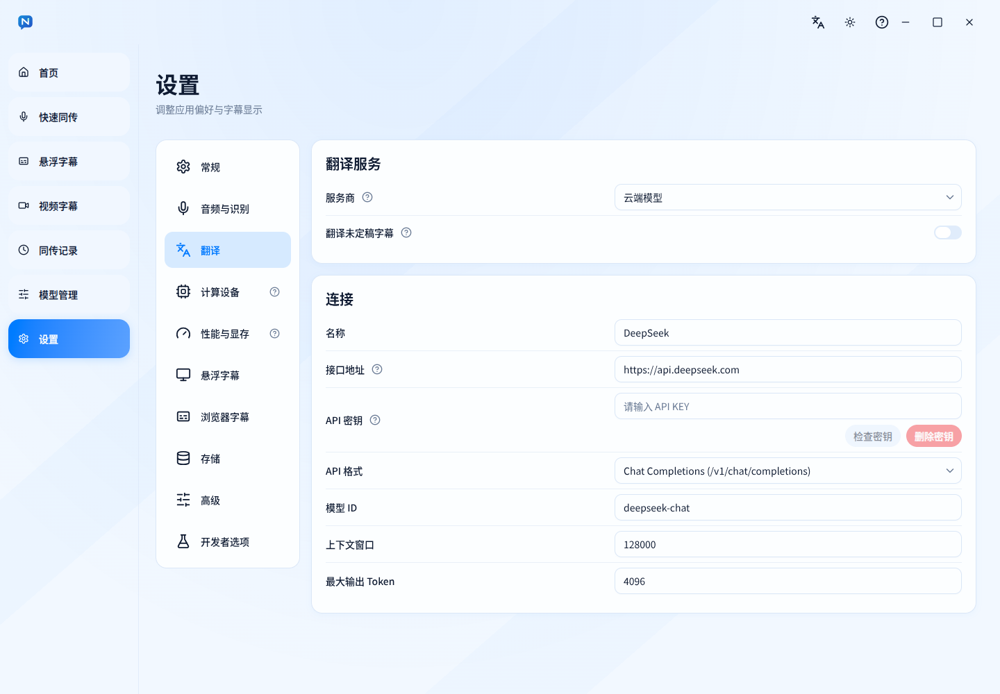

<div align="center">
  
  <h1>Nola Translator</h1>
  <p>即時字幕及翻譯軟件</p>
  <p><a href="README.md">English</a> · <a href="README.zh-CN.md">简体中文</a> · <a href="README.zh-TW.md">繁體中文（台灣）</a> · <a href="README.zh-HK.md">繁體中文（香港）</a> · <a href="README.ja.md">日本語</a> · <a href="README.ko.md">한국어</a></p>
</div>

<p align="center">
  <a href="./LICENSE"></a>
  <a href="https://github.com/CerealAxis/Nola-Translator/actions/workflows/build.yml"></a>
  <a href="https://github.com/CerealAxis/Nola-Translator/actions/workflows/build.yml"></a>
  <a href="https://github.com/CerealAxis/Nola-Translator/releases"></a>
  <a href="https://github.com/CerealAxis/Nola-Translator/releases/latest"></a>
  
  
  
  
</p>

<p align="center">
  
</p>

## 項目簡介

Nola Translator 是一款即時字幕及翻譯軟件，支援本地模型及雲端模型。你可以按需要使用本地運算資源進行語音辨識及翻譯，亦可以連接雲端模型進行辨識及翻譯。

## 功能特色

- **本地模型:** 可在本機執行 Qwen3-ASR、SenseVoiceSmall 等辨識模型，以及 HY-MT2 等翻譯模型。軟件亦可搜尋及安裝 Hugging Face 上的其他模型。
- **雲端模型:** 支援阿里雲、MiniMax 等雲端 ASR 模型；支援 OpenAI 相容 API、Anthropic、Ollama 等 LLM 協定，亦支援免費的 MyMemory 翻譯服務。
- **GPU 加速:** 偵測可用的運算裝置，並可分別為辨識及翻譯指定裝置。
- **瀏覽器擴充功能:** 提供適用於 Chrome 及 Edge 的擴充功能，可在影片網頁顯示雙語字幕，亦可將桌面系統音訊設為輸入來源。
- **即時字幕浮窗:** 支援系統輸出、指定音訊裝置或麥克風。字幕會顯示於獨立浮窗，可調整位置、字型大小、顏色、透明度，以及原文與譯文的版面。
- **彈性設定:** 按需要安裝模型，選擇辨識及翻譯方式、語言方向、運算裝置及字幕樣式；API 憑證由應用程式安全儲存。
- **記錄及匯出:** 儲存字幕記錄並匯出為 TXT、SRT 或 WebVTT。錄音儲存功能可自行啟用。

## 介面預覽

| 首頁 | 浮動字幕 | 影片字幕 |
|---|---|---|
|  |  |  |

| 本地模型安裝 | 推論環境設定 | 深色模式 |
|---|---|---|
|  |  |  |

## 安裝

- [下載最新版本](https://github.com/CerealAxis/Nola-Translator/releases/latest)

目前支援 Windows x64，可選擇 EXE 或 MSI 安裝程式。其他平台將於軟件開發穩定後支援。

## 支援辨識的語言

> [!TIP]
> 可辨識及翻譯的語言取決於所選模型的能力。下表列出軟件內置推薦模型的支援情況。如有推薦模型，歡迎提交 issue，我們會評估是否納入。初次使用者可先選擇 **SenseVoiceSmall** 作為辨識模型，以及 **HY-MT2 1.8B** 作為翻譯模型。

### 辨識模型

| 模型 | 語言數量 | 詳細資訊 |
|---|---:|---|
| Qwen3-ASR 1.7B | 30 | 支援自動偵測；中文、英文、廣東話、阿拉伯文、德文、法文、西班牙文、葡萄牙文、印尼文、意大利文、韓文、俄文、泰文、越南文、日文、土耳其文、印地文、馬來文、荷蘭文、瑞典文、丹麥文、芬蘭文、波蘭文、捷克文、菲律賓文、波斯文、希臘文、匈牙利文、馬其頓文、羅馬尼亞文 |
| Qwen3-ASR 0.6B | 30 | 支援自動偵測；中文、英文、廣東話、阿拉伯文、德文、法文、西班牙文、葡萄牙文、印尼文、意大利文、韓文、俄文、泰文、越南文、日文、土耳其文、印地文、馬來文、荷蘭文、瑞典文、丹麥文、芬蘭文、波蘭文、捷克文、菲律賓文、波斯文、希臘文、匈牙利文、馬其頓文、羅馬尼亞文 |
| SenseVoiceSmall | 5 | 中文、英語、粵語、日語及韓語 |

### 翻譯模型

| 模型 | 語言數量 | 詳細資訊 |
|---|---:|---|
| HY-MT2 1.8B | 37 | 簡體中文、繁體中文、英文、法文、葡萄牙文、西班牙文、日文、土耳其文、俄文、阿拉伯文、韓文、泰文、意大利文、德文、越南文、馬來文、印尼文、菲律賓文、印地文、波蘭文、捷克文、荷蘭文、高棉文、緬甸文、波斯文、古吉拉特文、烏爾都文、泰盧固文、馬拉地文、希伯來文、孟加拉文、泰米爾文、烏克蘭文、藏文、哈薩克文、蒙古文、維吾爾文 |
| M2M100 418M | 100 | 南非荷蘭文、岩哈拉語、阿拉伯文、阿斯圖里亞文、阿塞拜疆文、巴什基爾文、白俄羅斯文、保加利亞文、孟加拉文、布里多尼文、波斯尼亞文、加泰隆尼亞文、宿霧文、捷克文、威爾斯文、丹麥文、德文、希臘文、英文、西班牙文、愛沙尼亞文、波斯文、富拉文、芬蘭文、法文、西弗里西亞文、愛爾蘭文、蘇格蘭蓋爾文、加里西亞文、古吉拉特文、豪薩文、希伯來文、印地文、克羅地亞文、海地文、匈牙利文、亞美尼亞文、印尼文、伊博文、伊洛闊文、冰島文、意大利文、日文、爪哇文、格魯吉亞文、哈薩克文、高棉文、坎納達文、韓文、盧森堡文、干達文、林加拉文、老撾文、立陶宛文、拉脫維亞文、馬拉加斯文、馬其頓文、馬拉雅拉姆文、蒙古文、馬拉地文、馬來文、緬甸文、尼泊爾文、荷蘭文、挪威文、北索托文、奧克西坦文、奧里雅文、旁遮普文、波蘭文、普什圖文、葡萄牙文、羅馬尼亞文、俄文、信德文、僧伽羅文、斯洛伐克文、斯洛文尼亞文、索馬里文、阿爾巴尼亞文、塞爾維亞文、斯瓦特文、巽他文、瑞典文、史瓦希里文、泰米爾文、泰文、菲律賓文、突尼西亞文、土耳其文、烏克蘭文、烏爾都文、烏茲別克文、越南文、沃洛夫文、科薩文、意第緒文、約魯巴文、中文、祖魯文 |

## 雲端模型

| 服務商 | 模型 | 支援語言 | 詳細資訊 |
|---|---|---|---|
| Aliyun | Qwen3.5 / Qwen3.8 LiveTranslate | 60 | 中文、英文、阿拉伯文、德文、法文、西班牙文、葡萄牙文、印尼文、意大利文、韓文、俄文、泰文、越南文、日文、土耳其文、印地文、馬來文、荷蘭文、烏爾都文、書面挪威文、瑞典文、丹麥文、希伯來文、芬蘭文、波蘭文、冰島文、捷克文、菲律賓文、波斯文、廣東話、希臘文、南非荷蘭文、阿斯圖里亞文、白俄羅斯文、保加利亞文、孟加拉文、波斯尼亞文、加泰隆尼亞文、宿霧文、愛沙尼亞文、加里西亞文、古吉拉特文、克羅地亞文、匈牙利文、爪哇文、哈薩克文、坎納達文、吉爾吉斯文、拉脫維亞文、馬其頓文、馬拉雅拉姆文、馬拉地文、旁遮普文、羅馬尼亞文、斯洛伐克文、斯洛文尼亞文、史瓦希里文、塔吉克文、阿塞拜疆文、烏克蘭文。3.8 會自動偵測來源語言；3.5 可指定來源語言。 |
| MiniMax | Speech-to-Text `asr-1.0` | 20 | 阿拉伯文、廣東話、中文、英文、菲律賓文、法文、德文、印尼文、意大利文、日文、韓文、馬來文、波蘭文、葡萄牙文、俄文、西班牙文、泰文、土耳其文、烏克蘭文、越南文 |

## LLM API 設定

> [!TIP]
> 此處的 LLM 協定用於翻譯。阿里雲及 MiniMax ASR 模型使用「音訊與辨識」中的獨立連線設定及憑證。本地模型毋須 API 設定。

### 支援的協定

軟件支援以下 API 協定：

| 協定 |
|---|
| OpenAI Chat Completions |
| OpenAI Responses |
| Anthropic Messages |
| Ollama Chat |

### 設定範例

| 服務商 | API 格式 | API URL 範例 | 模型 ID 範例 |
|---|---|---|---|
| DeepSeek | OpenAI Chat Completions | `https://api.deepseek.com` | `deepseek-flash` |
| MiniMax | OpenAI Chat Completions | `https://api.minimax.io/v1` | `MiniMax-M3` |
| MiMo | OpenAI Chat Completions | `https://api.xiaomimimo.com/v1` | `mimo-v2.6-pro` |

### 設定步驟



1. 在翻譯設定中選擇 **雲端翻譯**。
2. 選擇服務商支援的 **API 格式**。
3. 輸入 **API URL**、**API 金鑰**及**模型 ID**。
4. 按需要調整上下文長度及最大輸出 Token 數。

## 項目結構

```text
assets/brand/                  標誌及品牌素材
docs/                          VitePress 產品網站及多語言文件
engine/nola_translator_engine/  Python 音訊、辨識及翻譯引擎
engine/tests/                   Python 測試
scripts/                        安裝及建置指令碼
src/main/                       Electron 主程序
src/preload/                    IPC 橋接
src/renderer/                   React 介面
src/shared/                     共用契約及設定
tests/                          應用程式測試
```

## 開發及建置

```powershell
npm run typecheck
npm test
.\.venv\Scripts\python.exe -m pytest engine\tests
npm run build
```

建置 Windows x64 安裝程式：

```powershell
npm run dist:win
```

## 參與貢獻

Fork 專案、建立分支、提交變更並發起 Pull Request。請簡要說明變更內容及執行過的檢查。設計及程式碼規範請參閱 [DESIGN.md](DESIGN.md) 及 [AGENTS.md](AGENTS.md)。

## 授權

Nola Translator 原始程式碼採用 [GNU GPL v3.0 only](LICENSE) 授權。第三方元件及模型依各自授權條款使用，詳情請參閱 [Third-Party Notices](THIRD_PARTY_NOTICES.md)。

[](https://star-history.com/#CerealAxis/Nola-Translator)
