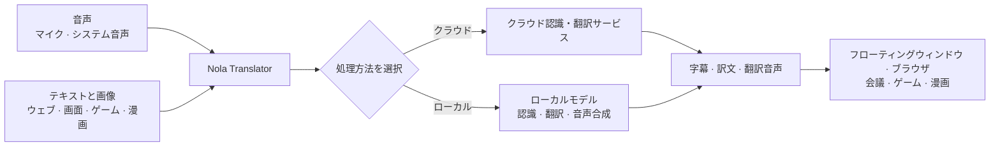

# 製品紹介

<div align="center">
  
  <p class="intro-product-name"><strong>Nola Translator</strong></p>
  <p>ブラウザ拡張機能も提供するオープンソースのリアルタイム翻訳ソフトウェア</p>
  <p><a href="https://github.com/CerealAxis/Nola-Translator/blob/main/README.md">English</a> · <a href="https://github.com/CerealAxis/Nola-Translator/blob/main/README.zh-CN.md">简体中文</a> · <a href="https://github.com/CerealAxis/Nola-Translator/blob/main/README.zh-TW.md">繁體中文（台灣）</a> · <a href="https://github.com/CerealAxis/Nola-Translator/blob/main/README.zh-HK.md">繁體中文（香港）</a> · <a href="https://github.com/CerealAxis/Nola-Translator/blob/main/README.ja.md">日本語</a> · <a href="https://github.com/CerealAxis/Nola-Translator/blob/main/README.ko.md">한국어</a></p>
</div>

<p align="center">
  <a href="https://github.com/CerealAxis/Nola-Translator/blob/main/LICENSE"></a>
  <a href="https://github.com/CerealAxis/Nola-Translator/actions/workflows/build.yml"></a>
  <a href="https://github.com/CerealAxis/Nola-Translator/actions/workflows/build.yml"></a>
  <a href="https://github.com/CerealAxis/Nola-Translator/releases"></a>
  <a href="https://github.com/CerealAxis/Nola-Translator/releases/latest"></a>
  
  
  
  
</p>

Nola Translator は、Windows デスクトップとブラウザに対応したリアルタイム翻訳アプリです。ローカル推論に加え、Qwen、MiniMax、OpenAI 互換 API、Google 翻訳、Microsoft Translator、Index Translate などのクラウドサービスを利用できます。リアルタイム字幕、会議通訳、漫画翻訳などの機能を提供します。

## デモ

<p align="center">
  <a href="https://nola.xaviermc.top/">
    
  </a>
</p>

> [!TIP]
> クリックしてオンラインデモを体験してください

## 仕組み



| | |
|---|---|
| **サービスプロバイダー** | Alibaba Cloud、MiniMax、OpenAI、Gemini、Anthropic、DeepSeek、Google Translate、Microsoft Translator、OpenAI 互換インターフェイス、Anthropic、Ollama など。|
| **ローカルモデル** | 26 個の ASR モデル、17 個の翻訳モデル、16 個の TTS モデル、3 個の LLM モデル、17 個の OCR モデル、5 個の漫画検出・分類モデル、3 個の画像復元モデル |
| **言語** | 60+ (音声認識) · 150+ (翻訳) · 29+ (音声合成) |
| **対応環境** | Windows x64 · Chrome · Edge · Firefox |
| **プライバシー** | ローカル推論はすべてデバイス上で実行されます。クラウドサービスの利用時は、関連する内容が選択したサービスプロバイダーに送信されます。 |

> [!TIP]
> ソフトウェアがサポートする言語は、選択したモデルによって決まります。モデルによってサポートされる言語機能が異なる場合があります。詳細については、ソフトウェアの設定を参照してください。

## インストール

Nola は**デスクトップアプリ**と**ブラウザ拡張機能**を提供します。デスクトップアプリはリアルタイム字幕、会議、画面、ゲーム、漫画に対応します。ブラウザ拡張機能はウェブページと動画字幕を翻訳でき、デスクトップのモデルにも接続できます。

> [!TIP]
> デスクトップ上の会議通訳、画面翻訳、ゲーム翻訳、漫画翻訳機能は試験的に開発中のものです。

| | デスクトップアプリ | ブラウザ拡張機能 |
|---|---|---|
| **機能** | モデルゲートウェイ、リアルタイム字幕、会議通訳、画面翻訳、ゲーム翻訳、漫画翻訳、ワークベンチ、用語集 | ウェブページ翻訳、動画字幕、文書翻訳、サービス構成、用語集 |
| **利用シーン** | コンピュータオーディオ、会議ソフトウェア、画面コンテンツ、ゲーム、コミック | ウェブページと動画 |
| **インストール方法** | インストールパッケージをダウンロードする | 拡張機能をダウンロードしてインストールする |
| **対応環境** | Windows x64 | Chrome · Edge · Firefox |

### デスクトップアプリ

- [GitHub Releases](https://github.com/CerealAxis/Nola-Translator/releases)
- [百度网盘](https://pan.baidu.com/s/1vq6wMwdJo_0FGo_lu6FfuA?pwd=kna2)
- [夸克网盘](https://pan.quark.cn/s/ef1e11262087)

### ブラウザ拡張機能

Nola デスクトップアプリのブラウザ設定から、拡張機能のダウンロードと管理ができます。拡張機能には翻訳サービスを個別に設定できます。デスクトップのモデルを利用する場合は、アプリでブラウザ接続を有効にしてください。

- [GitHub Releases](https://github.com/CerealAxis/Nola-Translator/releases)
- [百度网盘](https://pan.baidu.com/s/1vq6wMwdJo_0FGo_lu6FfuA?pwd=kna2)
- [夸克网盘](https://pan.quark.cn/s/ef1e11262087)

<details>
<summary>開発者モードで拡張機能をインストールする</summary>

1. Nola のブラウザ設定またはプロジェクト公開ページから拡張機能をダウンロードします。
2. 拡張ファイルを解凍します。
3. ブラウザで拡張機能管理ページを開き、開発者モードを有効にします。
4. 「解凍した拡張機能を読み込む」を選択し、解凍したフォルダーを選択します。

</details>

### ソースからビルドする

開発環境は Node.js 24、npm 11、Python 3.12 を使用します。

```powershell
git clone https://github.com/CerealAxis/Nola-Translator.git
cd Nola-Translator
npm ci
npm run dev       # 開発
npm run build     # デスクトップアプリをビルド
```

## 機能

### ローカル推論

- **音声認識**：ローカルの ASR モデルで音声を文字に変換します。
- **テキスト翻訳**：ローカル翻訳モデルで認識結果やその他のテキストを翻訳します。
- **音声合成**：設定した音声合成モデルで翻訳音声を生成します。
- **モデル管理**： オンデマンドでモデルをインストールし、コンピューティング デバイスを選択し、モデル ゲートウェイでモデルの機能と実行ステータスを管理します。

### クラウドサービス

| サービスまたはインターフェース | 主な目的 |
|---|---|
| **Alibaba Cloud LiveTranslate** | エンドツーエンドの音声翻訳 |
| **Alibaba Cloud、MiniMax** | クラウド音声認識 |
| **OpenAI互換インターフェース** | 互換性のあるクラウド言語モデルにアクセスして翻訳とテキスト処理を行う |
| **Anthropic** | Anthropic Messages プロトコルを使用してモデルにアクセスする |
| **Ollama** | Ollama モデルにアクセスする |
| **無料翻訳サービス** | Microsoft Translator、Google Translate、Index Translate などの無料翻訳サービスを利用します。 |

### 音声

- **リアルタイム通訳**：マイク、システムオーディオ、または指定したアプリケーションから音声を収集し、リアルタイムの字幕と翻訳を生成します。
- **会議通訳**： 会議の双方の発言を翻訳し、設定されたオーディオ デバイスを介して翻訳音声を再生または送信します。
- **ブラウザ字幕**： タブオーディオまたはシステムオーディオを使用して、ウェブ動画の字幕を表示します。
- **フローティング字幕**： 字幕を別ウィンドウで表示し、原文、翻訳、見た目を調整します。
- **履歴とエクスポート**：リアルタイム通訳の記録の保存、字幕のエクスポート、必要に応じた音声の保存が可能です。

### インターフェース

- **多言語インターフェース**： 簡体字中国語、繁体字中国語、英語、日本語、韓国語をサポートし、システム言語に従うこともできます。
- **ワークベンチ**： 設定されたモデルを対話、テキスト処理、その他のモデル機能の呼び出しに使用します。
- **画面翻訳**：画面やウィンドウ内の文字領域を選び、元の位置に翻訳を表示します。
- **ゲーム翻訳**： OCR、フック、またはクリップボードからゲーム テキストを取得し、フローティング ウィンドウを通じて翻訳を表示します。
- **漫画翻訳**： コミックをインポートし、プロジェクト内で識別、翻訳、修復、組版、編集を実行します。
- **用語集**： 用語を管理し、サポートされている翻訳シナリオで使用する用語を選択します。

## コントリビューション

Issue や Pull Request を歓迎します。始める前に、[プロジェクトの開発規約](https://github.com/CerealAxis/Nola-Translator/blob/main/AGENTS.md)と[デザイン規範](https://github.com/CerealAxis/Nola-Translator/blob/main/docs/design-system/DESIGN.md)をご確認ください。

## スポンサー

Nola Translator のその後の開発をサポートしたい場合は、次の方法でスポンサーになることができます。

- [爱发电](https://afdian.com/a/CerealAxis)
- [GitHub Sponsors](https://github.com/sponsors/CerealAxis/)

## サポート

- [Issues](https://github.com/CerealAxis/Nola-Translator/issues) — 問題を報告する
- [Discussions](https://github.com/CerealAxis/Nola-Translator/discussions) — 質問してコミュニケーションを取る
- [ヘルプドキュメント](https://nola.xaviermc.top/ja/docs) — ヘルプドキュメント

## 参考プロジェクト

| プロジェクト | ライセンス |
| --- | --- |
| [X-Translator](https://github.com/zhaoyx239/X-Translator) | [MIT](https://github.com/zhaoyx239/X-Translator#acknowledgements) |
| [FluentRead](https://github.com/FluentRead/FluentRead) | [GPL-3.0](https://github.com/FluentRead/FluentRead/blob/main/LICENSE) |
| [Sokuji](https://github.com/kizuna-ai-lab/sokuji) | [AGPL-3.0](https://github.com/kizuna-ai-lab/sokuji/blob/main/LICENSE) |
| [Lumina](https://github.com/lumina-tl/lumina) | [MIT](https://github.com/lumina-tl/lumina/blob/main/LICENSE) |
| [PhotoCraft](https://github.com/storytold/photocraft) | [MIT](https://github.com/storytold/photocraft/blob/main/LICENSE-MIT) または [Apache-2.0](https://github.com/storytold/photocraft/blob/main/LICENSE-APACHE) |

## ライセンス

Nola Translator のオリジナルのソフトウェアコードは [GPL-3.0-only](https://github.com/CerealAxis/Nola-Translator/blob/main/LICENSE)、ドキュメントのオリジナル部分は [CC BY-SA 4.0](https://github.com/CerealAxis/Nola-Translator/blob/main/LICENSE-DOCUMENTATION) の下で提供されます。

サードパーティのコンポーネント、モデル、フォント、アイコンなどには、それぞれのライセンスが適用されます。著作権とライセンスの詳細は[サードパーティ通知](https://github.com/CerealAxis/Nola-Translator/blob/main/THIRD_PARTY_NOTICES.md)および各ファイルの記載をご確認ください。

Nola Translator の名称、ワードマーク、ロゴは、上記のオープンソースライセンスによるブランド使用許諾の対象外です。使用条件は[ブランド使用に関する声明](https://github.com/CerealAxis/Nola-Translator/blob/main/LICENSE-BRAND)をご確認ください。

## Star History

[](https://star-history.com/#CerealAxis/Nola-Translator)
