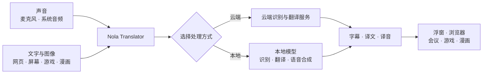

# 产品介绍

<div align="center">
  
  <h1>Nola Translator</h1>
  <p>一款开源的实时翻译软件，提供浏览器插件版本</p>
  <p><a href="https://github.com/CerealAxis/Nola-Translator/blob/main/README.md">English</a> · 简体中文 · <a href="https://github.com/CerealAxis/Nola-Translator/blob/main/README.zh-TW.md">繁體中文（台灣）</a> · <a href="https://github.com/CerealAxis/Nola-Translator/blob/main/README.zh-HK.md">繁體中文（香港）</a> · <a href="https://github.com/CerealAxis/Nola-Translator/blob/main/README.ja.md">日本語</a> · <a href="https://github.com/CerealAxis/Nola-Translator/blob/main/README.ko.md">한국어</a></p>
</div>

<p align="center">
  <a href="https://github.com/CerealAxis/Nola-Translator/blob/main/LICENSE"></a>
  <a href="https://github.com/CerealAxis/Nola-Translator/actions/workflows/build.yml"></a>
  <a href="https://github.com/CerealAxis/Nola-Translator/actions/workflows/build.yml"></a>
  <a href="https://github.com/CerealAxis/Nola-Translator/releases"></a>
  <a href="https://github.com/CerealAxis/Nola-Translator/releases/latest"></a>
  
  
  
  
</p>

Nola Translator 是一款跨平台实时翻译应用，支持 Windows 桌面端和浏览器端；支持本地推理；同时可以接入千问、MiniMax、OpenAI 兼容接口、谷歌翻译、微软翻译、Index Translate 等云端服务商。提供实时字幕、会议口译、漫画翻译等功能。

## 演示

<p align="center">
  <a href="https://nola.xaviermc.top/">
    
  </a>
</p>

> [!TIP]
> 点击体验在线演示

## 工作方式



| | |
|---|---|
| **服务商** | 阿里云、MiniMax、OpenAI、Gemini、Anthropic、DeepSeek、Google 翻译、Microsoft Translator、OpenAI 兼容接口、Anthropic、Ollama 等|
| **本地模型** | 26 个 ASR 模型、17 个翻译模型、16 个 TTS 模型、3 个 LLM 模型、17 个 OCR 模型、5 个漫画检测与分类模型、3 个图像修复模型 |
| **语言** | 60+（语音识别）· 150+（翻译）· 29+（语音合成） |
| **平台** | Windows x64 · Chrome · Edge · Firefox |
| **隐私** | 本地推理 = 100% 设备端运行，使用云端服务时，相关内容会发送给所选服务商 |

> [!TIP]
> 软件支持的语言由所选择的模型决定，不同模型支持的语言能力可能不同，具体请以软件中的配置为准

## 安装

Nola 提供**桌面应用**和**浏览器扩展**。桌面端覆盖实时字幕、会议、屏幕、游戏和漫画等场景；浏览器扩展提供网页翻译与视频字幕，并可连接桌面端调用模型能力。

> [!TIP]
> 桌面端的会议口译、屏幕翻译、游戏翻译、漫画翻译功能为实验性功能，正在开发中

| | 桌面应用 | 浏览器扩展 |
|---|---|---|
| **功能** | 模型网关、实时字幕、会议口译、屏幕翻译、游戏翻译、漫画翻译、工作台、术语库 | 网页翻译、视频字幕、文档翻译、服务配置、术语库 |
| **使用场景** | 电脑音频、会议软件、屏幕内容、游戏和漫画 | 网页及视频 |
| **安装方式** | 下载安装包 | 下载并安装扩展 |
| **平台** | Windows x64 | Chrome · Edge · Firefox |

### 桌面应用

- [Github Release](https://github.com/CerealAxis/Nola-Translator/releases)
- [百度网盘](https://pan.baidu.com/s/1vq6wMwdJo_0FGo_lu6FfuA?pwd=kna2)
- [夸克网盘](https://pan.quark.cn/s/ef1e11262087)

### 浏览器扩展

在 Nola 桌面端的浏览器设置中下载和管理扩展。扩展可以单独配置翻译服务；如需调用桌面端模型，请在软件中启用浏览器连接。

- [Github Release](https://github.com/CerealAxis/Nola-Translator/releases)
- [百度网盘](https://pan.baidu.com/s/1vq6wMwdJo_0FGo_lu6FfuA?pwd=kna2)
- [夸克网盘](https://pan.quark.cn/s/ef1e11262087)

<details>
<summary>在开发者模式下安装扩展</summary>

1. 从 Nola 的浏览器设置或项目发布页下载扩展。
2. 解压扩展文件。
3. 在浏览器中打开扩展管理页面，并启用开发者模式。
4. 选择“加载已解压的扩展程序”，选择解压后的文件夹。

</details>

### 从源码构建

开发环境使用 Node.js 24、npm 11 和 Python 3.12。

```powershell
git clone https://github.com/CerealAxis/Nola-Translator.git
cd Nola-Translator
npm ci
npm run dev       # 开发
npm run build     # 构建桌面应用
```

## 功能

### 本地推理

- **语音识别**：使用本地 ASR 模型，将音频转换为文字。
- **文本翻译**：使用本地翻译模型处理识别结果和其他文本。
- **语音合成**：使用已配置的语音合成模型生成译音。
- **模型管理**：按需安装模型，选择计算设备，并在模型网关中管理模型能力和运行状态。

### 云端服务

| 服务或接口 | 主要用途 |
|---|---|
| **阿里云 LiveTranslate** | 端到端语音翻译 |
| **阿里云、MiniMax** | 云端语音识别 |
| **OpenAI 兼容接口** | 接入兼容的云端语言模型，用于翻译和文本处理 |
| **Anthropic** | 接入使用 Anthropic Messages 协议的模型 |
| **Ollama** | 接入 Ollama 模型 |
| **免费翻译服务** | 使用应用提供的免费翻译接口，如微软翻译、谷歌翻译、Index Translate等 |

### 音频

- **快速同传**：采集麦克风、系统音频或指定应用的声音，生成实时字幕和译文。
- **会议口译**：翻译会议双方发言，通过配置的音频设备播放或发送译音。
- **浏览器字幕**：使用标签页音频或系统音频，为网页视频显示字幕。
- **悬浮字幕**：在独立窗口中显示字幕，调整原文、译文和外观。
- **记录与导出**：保存同传记录，导出字幕，并按需保存录音。

### 界面

- **多语言界面**：支持简体中文、繁体中文、英语、日语和韩语，也可跟随系统语言。
- **工作台**：使用已配置的模型进行对话、文本处理和其他模型能力调用。
- **屏幕翻译**：选择屏幕或窗口中的文字区域，在原位置显示译文。
- **游戏翻译**：从 OCR、Hook 或剪贴板获取游戏文本，通过浮窗显示译文。
- **漫画翻译**：导入漫画，在工程中进行识别、翻译、修复、排版和编辑。
- **术语库**：管理术语，并在支持的翻译场景中选择使用。

## 参与贡献

欢迎提交 Issue 和 Pull Request。开始之前，请参考[项目工程规范](https://github.com/CerealAxis/Nola-Translator/blob/main/AGENTS.md)与[设计规范](https://github.com/CerealAxis/Nola-Translator/blob/main/docs/design-system/DESIGN.md)。

## 赞助

如果你希望支持 Nola Translator 的后续开发，可以通过以下方式赞助：

- [爱发电](https://afdian.com/a/CerealAxis)
- [GitHub Sponsors](https://github.com/sponsors/CerealAxis/)

## 获取帮助

- [Issues](https://github.com/CerealAxis/Nola-Translator/issues) — 报告问题
- [Discussions](https://github.com/CerealAxis/Nola-Translator/discussions) — 提问与交流
- [帮助文档](https://nola.xaviermc.top/zh-CN/docs) — 帮助文档

## 参考项目

| 项目 | 许可证 |
| --- | --- |
| [X-Translator](https://github.com/zhaoyx239/X-Translator) | [MIT](https://github.com/zhaoyx239/X-Translator#acknowledgements) |
| [流畅阅读（FluentRead）](https://github.com/FluentRead/FluentRead) | [GPL-3.0](https://github.com/FluentRead/FluentRead/blob/main/LICENSE) |
| [Sokuji](https://github.com/kizuna-ai-lab/sokuji) | [AGPL-3.0](https://github.com/kizuna-ai-lab/sokuji/blob/main/LICENSE) |
| [Lumina](https://github.com/lumina-tl/lumina) | [MIT](https://github.com/lumina-tl/lumina/blob/main/LICENSE) |
| [PhotoCraft](https://github.com/storytold/photocraft) | [MIT](https://github.com/storytold/photocraft/blob/main/LICENSE-MIT) 或 [Apache-2.0](https://github.com/storytold/photocraft/blob/main/LICENSE-APACHE) |

## 许可证

Nola Translator 的原创软件代码采用 [GPL-3.0-only](https://github.com/CerealAxis/Nola-Translator/blob/main/LICENSE)，文档中的原创内容采用 [CC BY-SA 4.0](https://github.com/CerealAxis/Nola-Translator/blob/main/LICENSE-DOCUMENTATION)。

项目使用的第三方组件、模型、字体、图标及其他资源遵循各自的许可协议。相关版权和许可信息见[第三方组件声明](https://github.com/CerealAxis/Nola-Translator/blob/main/THIRD_PARTY_NOTICES.md)及对应文件中的说明。

Nola Translator 的名称、文字标识及品牌标志不在上述开源许可证的品牌授权范围内。品牌标识的使用条件见[品牌使用声明](https://github.com/CerealAxis/Nola-Translator/blob/main/LICENSE-BRAND)。

## Star History

[](https://star-history.com/#CerealAxis/Nola-Translator)
